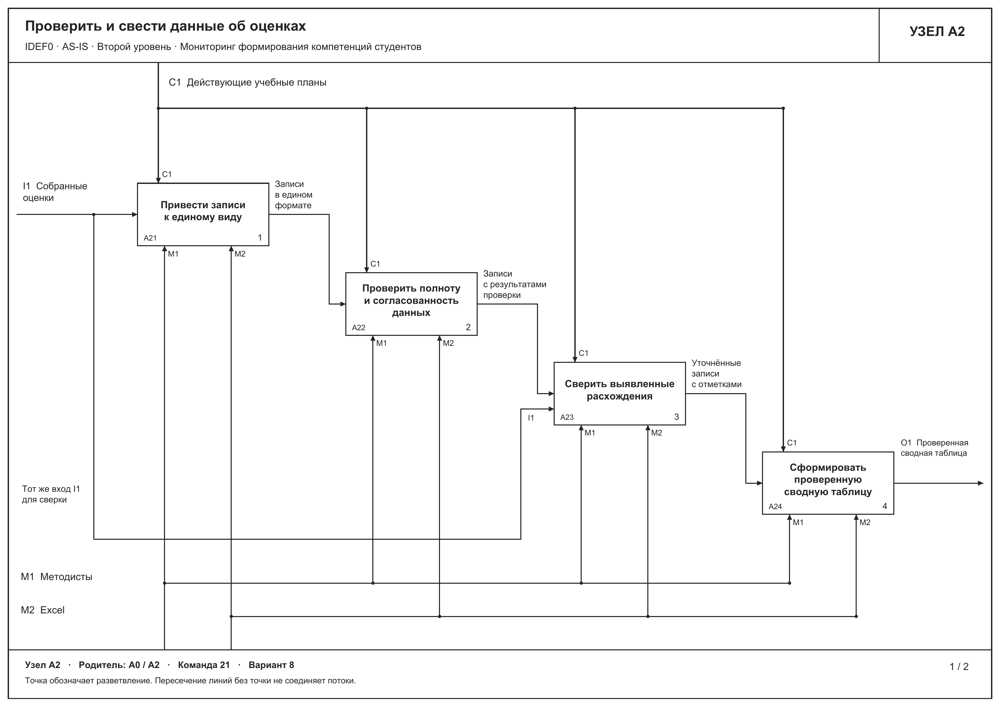
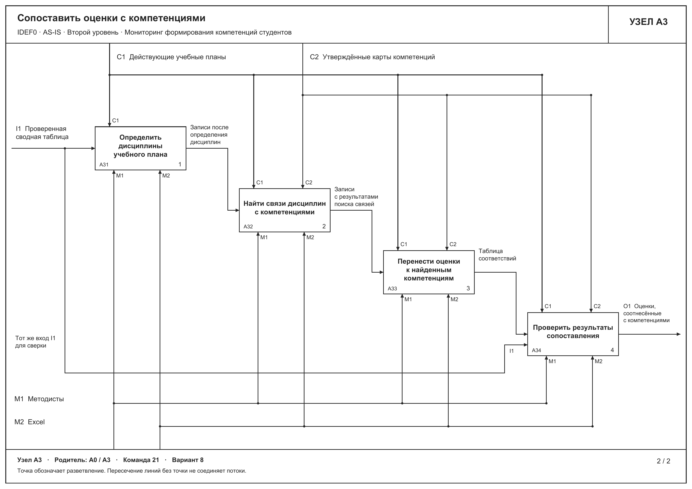

# 3. Декомпозиция бизнес-процесса AS-IS на втором уровне

На втором уровне детализированы блоки A2 «Проверить и свести данные об оценках» и A3 «Сопоставить оценки с компетенциями» диаграммы A0. Эти функции выполняются после сессии и охватывают подготовку сводных данных и ручное сопоставление оценок с картой компетенций. Для обеих диаграмм использована нотация IDEF0. Точка зрения модели сохраняется, процесс рассматривается со стороны руководителя образовательной программы.

Подфункции уточняют действия родительских блоков. Порядок проверки записей и сохранения отметок о расхождениях принят при детализации модели. Отдельный регламент обработки ошибок в исходном описании процесса не задан.

## 3.1. Проверка и сведение данных об оценках

Рисунок 3.1. Декомпозиция A2 «Проверить и свести данные об оценках».

На вход A2 поступают собранные в A1 оценки из Moodle и бумажных ведомостей. Методист приводит записи к единому виду, проверяет их по действующему учебному плану и собирает сводную таблицу в Excel. Внутри функции выделены четыре подфункции.

| Узел | Подфункция | Содержание работы |
| --- | --- | --- |
| A21 | Привести записи к единому виду | Согласовать обозначения студентов, дисциплин и учебного периода в собранных записях. Сохранить исходные значения оценок и возможность сверки с источником. |
| A22 | Проверить полноту и согласованность данных | Найти пропуски в оценках по дисциплинам учебного плана, повторяющиеся записи и противоречия между полученными данными. Передать весь набор записей вместе с результатами проверки. |
| A23 | Сверить выявленные расхождения | Сравнить отмеченные записи с уже собранными исходными оценками. Исправить подтвержденные ошибки переноса. Отметить расхождения и пропуски, которые не удалось устранить по имеющимся данным. |
| A24 | Сформировать проверенную сводную таблицу | Объединить уточненные записи, сохранить отметки о неустраненных расхождениях и передать сводную таблицу для сопоставления с компетенциями. |

Исходные оценки дополнительно поступают в A23 по ответвлению входной стрелки. Это позволяет сверять подготовленные записи с полученными данными. Повторный сбор оценок относится к A1 и в данной декомпозиции не рассматривается.

Выход A2 сохраняет название «Проверенная сводная таблица». Проверенная таблица содержит результат проверки и может включать отмеченные пропуски. Отсутствующую оценку не заменяют нулем, противоречащие друг другу значения не выбирают произвольно. Если исходных сведений недостаточно, это ограничение сохраняют в таблице для дальнейшей работы.

## 3.2. Сопоставление оценок с компетенциями

Рисунок 3.2. Декомпозиция A3 «Сопоставить оценки с компетенциями».

На вход A3 поступает проверенная сводная таблица. Методист определяет дисциплины по действующему учебному плану, находит их связи с компетенциями в утвержденной карте и вручную заполняет таблицу соответствий в Excel.

| Узел | Подфункция | Содержание работы |
| --- | --- | --- |
| A31 | Определить дисциплины учебного плана | Соотнести записи сводной таблицы с дисциплинами и периодом обучения в действующем учебном плане. Сохранить оценки и отметки о проблемных записях. |
| A32 | Найти связи дисциплин с компетенциями | Для каждой найденной дисциплины определить связанные компетенции по утвержденной карте. Если связь в карте отсутствует или неоднозначна, сохранить отметку для проверки. |
| A33 | Перенести оценки к найденным компетенциям | Заполнить строки соответствий «студент, дисциплина, оценка, компетенция». Если дисциплина связана с несколькими компетенциями, отразить каждую связь с сохранением исходной оценки. Записи без найденной связи и прежние отметки о пропусках и расхождениях сохранить. |
| A34 | Проверить результаты сопоставления | Сверить таблицу соответствий с исходным сводом, учебным планом и картой компетенций. Проверить полноту связей и сохранность оценок. Исправить обнаруженные ошибки переноса и сохранить отметки о неустраненных проблемах. |

Результат A3 представляет собой оценки, соотнесенные с компетенциями. Он передается в A4 «Обобщить результаты освоения компетенций». На данном уровне устанавливается связь оценки по дисциплине с компетенцией. Числовой уровень освоения компетенции здесь не рассчитывается. В описании AS-IS второй работы указано, что единых правил расчета вклада дисциплин пока нет.

## 3.3. Соответствие диаграмме первого уровня

Граничные стрелки обеих декомпозиций соответствуют стрелкам родительских блоков A2 и A3. Внутренние промежуточные таблицы уточняют содержание работы и остаются внутри границ соответствующей функции.

| Вид связи | Диаграмма A2 | Диаграмма A3 |
| --- | --- | --- |
| I1, вход | Собранные оценки, выход A1 | Проверенная сводная таблица, выход A2 |
| C1, управление | Действующие учебные планы | Действующие учебные планы |
| C2, управление | Не входит в родительский блок A2 | Утверждённые карты компетенций |
| M1, механизм | Методисты | Методисты |
| M2, механизм | Excel | Excel |
| O1, выход | Проверенная сводная таблица, вход A3 | Оценки, соотнесённые с компетенциями, вход A4 |

Коды ICOM на дочерних диаграммах отсчитываются относительно своего родительского блока. У A2 и A3 два механизма, методисты и Excel. Поэтому Excel обозначен M2 на втором уровне. На общей диаграмме A0 тот же ресурс имеет обозначение M4. Состав механизмов при этом сохраняется.

Moodle участвует в получении оценок в A1. Руководитель образовательной программы участвует в подготовке итогового отчета в A5. В A2 и A3 исполнитель остается прежним, методист работает в Excel.

Декомпозиция показывает, где возникают ошибки переноса и сопоставления данных. Все проверки выполняются вручную после сессии. Качество результата зависит от полноты исходных оценок и корректности связей в утвержденной карте компетенций.
