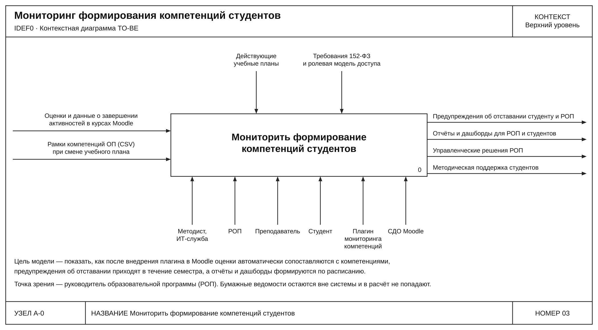
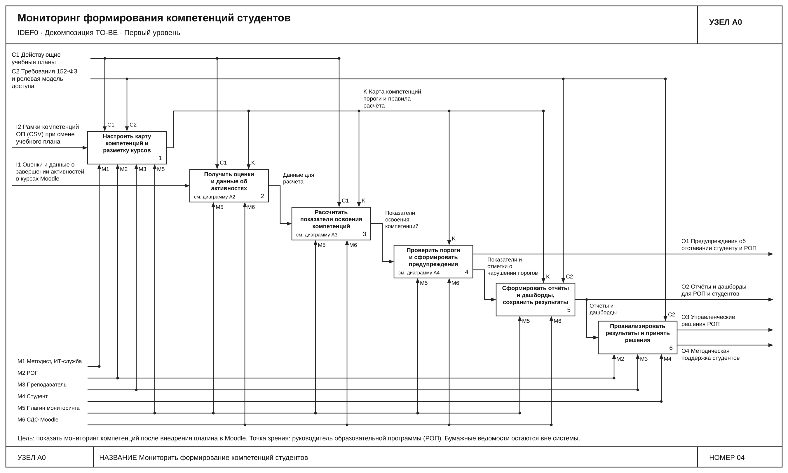
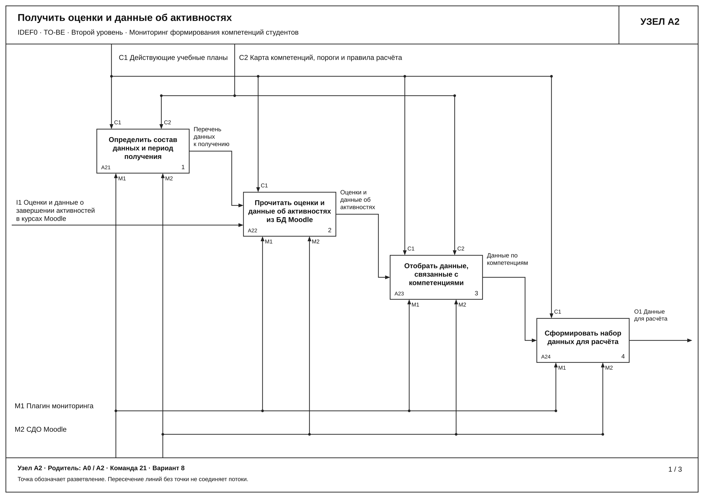
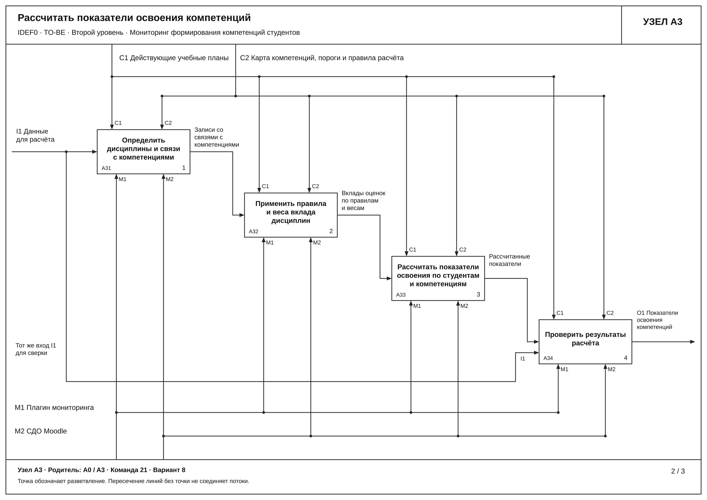
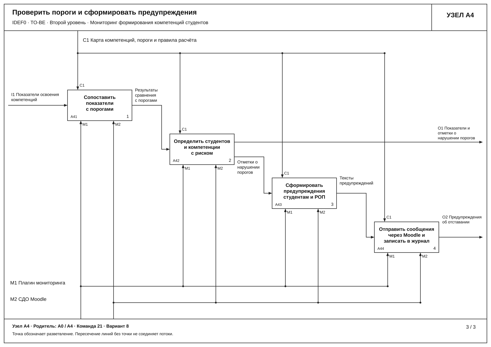

# 4. Модель бизнес-процесса TO-BE после внедрения информационной системы

Модель TO-BE построена для выбранного в работе 2 варианта C: плагин мониторинга компетенций внутри СДО Moodle поверх штатной подсистемы Competencies. Нотация IDEF0, точка зрения и цель те же, что в AS-IS: руководитель образовательной программы (РОП) и мониторинг формирования компетенций. Состав шагов соответствует BPMN-схеме TO-BE из раздела 5 отчёта по работе 2 (рисунок 5.1). Бумажные ведомости остаются вне системы и в расчёт не попадают, это граница системы.

Построены контекстная диаграмма A-0, диаграмма первого уровня A0 и три декомпозиции второго уровня: A2, A3 и A4. Блоки A2 и A3 соответствуют блокам AS-IS с теми же номерами, A4 добавлена как новая функция (предупреждения). Единый файл со всеми схемами: `to-be-diagrams.pdf`.

## 4.1. Контекстная диаграмма A-0

Рисунок 4.1. Контекстная диаграмма TO-BE, функция «Мониторить формирование компетенций студентов».

| Вид связи | Стрелка |
| --- | --- |
| Вход | Оценки и данные о завершении активностей в курсах Moodle; рамки компетенций ОП (CSV) при смене учебного плана |
| Управление | Действующие учебные планы; требования 152-ФЗ и ролевая модель доступа |
| Выход | Предупреждения об отставании студенту и РОП; отчёты и дашборды для РОП и студентов; управленческие решения РОП; методическая поддержка студентов |
| Механизм | Методист и ИТ-служба; РОП; преподаватель; студент; плагин мониторинга компетенций; СДО Moodle |

По сравнению с AS-IS вход «оценки из бумажных ведомостей» исчез из модели, оценки читаются из Moodle внутри системы. Главный выход вместо одного сводного отчёта после сессии стал набором результатов, которые доступны в течение семестра. Карта компетенций перестала быть внешним управлением и формируется внутри процесса.

## 4.2. Декомпозиция первого уровня A0

Рисунок 4.2. Декомпозиция A0 TO-BE.

| Блок | Функция | Содержание работы |
| --- | --- | --- |
| A1 | Настроить карту компетенций и разметку курсов | Методист или ИТ-служба загружает рамки компетенций из CSV. РОП формирует карту, задаёт пороги и правила расчёта, плагин сохраняет версию и запись в журнале. Преподаватель размечает активности курсов Moodle компетенциями |
| A2 | Получить оценки и данные об активностях | Плагин по расписанию читает оценки и данные о завершении активностей из Moodle без выгрузок |
| A3 | Рассчитать показатели освоения компетенций | Плагин связывает оценки с компетенциями и рассчитывает показатели по единым правилам и весам |
| A4 | Проверить пороги и сформировать предупреждения | Показатели сравниваются с порогами, при нарушении студент и РОП получают сообщение Moodle |
| A5 | Сформировать отчёты и дашборды, сохранить результаты | Отчёты по студентам, компетенциям, программе и когортам, дашборд студента. Результаты и журнал хранятся в БД Moodle |
| A6 | Проанализировать результаты и принять решения | РОП анализирует отчёты и принимает решения, студент смотрит прогресс и при необходимости просит помощи, преподаватель оказывает методическую поддержку |

Внутренние стрелки: «Карта компетенций, пороги и правила расчёта» (K) выходит из A1 и управляет A2–A5; «Данные для расчёта» A2→A3; «Показатели освоения компетенций» A3→A4; «Показатели и отметки о нарушении порогов» A4→A5; «Отчёты и дашборды» A5→A6 (ветвление: тот же поток выходит на границу как O2).

Соответствие AS-IS: A2 «Проверить и свести» и A3 «Сопоставить» заменены автоматическими A2 и A3, A4 «Обобщить» и A5 «Подготовить отчёт» вошли в A3 и A5. Новые функции: A1 (настройка и версии карты), A4 (предупреждения) и A6 (использование результатов). Ссылки на дочерние диаграммы указаны в блоках A2, A3, A4.

Соответствие BPMN (рис. 5.1): загрузка рамок, карта, пороги, разметка курсов → A1; получение оценок по расписанию → A2; расчёт показателей → A3; проверка порога, предупреждение, сообщение → A4; отчёты и сохранение в БД → A5; просмотр студентом, решения РОП, поддержка → A6. Проблемы AS-IS П1–П6 из таблицы 5.4: П1 снимается в A2 и A3, П2 в A4, П3 в A5 и A6, П4 в A5 и по ролям C2, П5 в A5, П6 частично в A1.

## 4.3. Декомпозиция A2 «Получить оценки и данные об активностях»

Рисунок 4.3. Декомпозиция A2 TO-BE.

| Узел | Подфункция | Содержание работы |
| --- | --- | --- |
| A21 | Определить состав данных и период получения | По расписанию и действующему учебному плану определить студентов, дисциплины и учебный период |
| A22 | Прочитать оценки и данные об активностях из БД Moodle | Прочитать оценки и данные о завершении активностей внутри Moodle, без выгрузок и ручного переноса |
| A23 | Отобрать данные, связанные с компетенциями | Оставить активности и элементы оценивания, размеченные компетенциями. Данные без разметки отметить |
| A24 | Сформировать набор данных для расчёта | Привести записи к виду «студент, дисциплина, активность, оценка» с сохранением исходных значений. Отсутствующую оценку не заменять нулём, а отметить |

Граничные стрелки соответствуют A2 на A0: I1 вход, C1 учебные планы, C2 карта, пороги и правила (K на A0), M1 плагин (M5 на A0), M2 СДО Moodle (M6 на A0), O1 «Данные для расчёта». В AS-IS эти действия выполнял методист вручную с проверкой и сведением в Excel, здесь ручной перенос исключён.

## 4.4. Декомпозиция A3 «Рассчитать показатели освоения компетенций»

Рисунок 4.4. Декомпозиция A3 TO-BE.

| Узел | Подфункция | Содержание работы |
| --- | --- | --- |
| A31 | Определить дисциплины и связи с компетенциями | По разметке курсов и карте найти компетенции, связанные с каждой записью. Записи без связи отметить |
| A32 | Применить правила и веса вклада дисциплин | Определить вклад оценки в компетенцию по единым правилам и весам, заданным РОП |
| A33 | Рассчитать показатели освоения по студентам и компетенциям | Агрегировать вклады в показатель освоения каждой компетенции студента |
| A34 | Проверить результаты расчёта | Автоматически сверить результат с исходными данными (вход I1 для сверки), проверить полноту связей и сохранность оценок, сохранить отметки о неполных данных |

Граничные стрелки соответствуют A3 на A0: I1 «Данные для расчёта», C1, C2 (K), M1, M2, O1 «Показатели освоения компетенций» (передаётся в A4). В AS-IS числовой показатель не рассчитывался, единых правил вклада дисциплин не было.

## 4.5. Декомпозиция A4 «Проверить пороги и сформировать предупреждения»

Рисунок 4.5. Декомпозиция A4 TO-BE.

| Узел | Подфункция | Содержание работы |
| --- | --- | --- |
| A41 | Сопоставить показатели с порогами | Сравнить показатель каждой компетенции студента с порогом из карты |
| A42 | Определить студентов и компетенции с риском | Отметить нарушения порогов. Показатели с отметками уходят в A5 |
| A43 | Сформировать предупреждения студентам и РОП | Подготовить текст с указанием компетенции, дисциплины, значения и порога |
| A44 | Отправить сообщения через Moodle и записать в журнал | Отправить штатные сообщения Moodle после очередного расчёта и записать действие в журнал |

Граничные стрелки соответствуют A4 на A0: I1 «Показатели освоения компетенций», C1 карта, пороги и правила (K на A0), M1 плагин, M2 СДО Moodle, O1 «Показатели и отметки о нарушении порогов» (в A5), O2 «Предупреждения об отставании» (на границу A0). В AS-IS функции предупреждения не было, РОП узнавал о проблемах после сессии.

## 4.6. Согласованность диаграмм

Коды ICOM на дочерних диаграммах отсчитываются от родительского блока, поэтому плагин и Moodle обозначены M1 и M2 на втором уровне и M5 и M6 на A0. Все граничные стрелки A2, A3 и A4 совпадают со стрелками соответствующих блоков A0, а внешние стрелки A0 совпадают со стрелками A-0. Точное сопоставление до и после для шага 6 даётся блоками с одинаковыми номерами A2 и A3.
