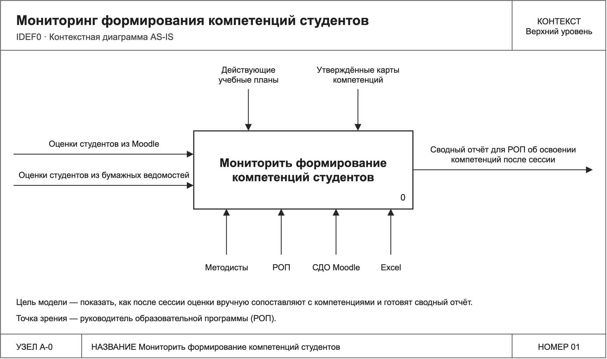
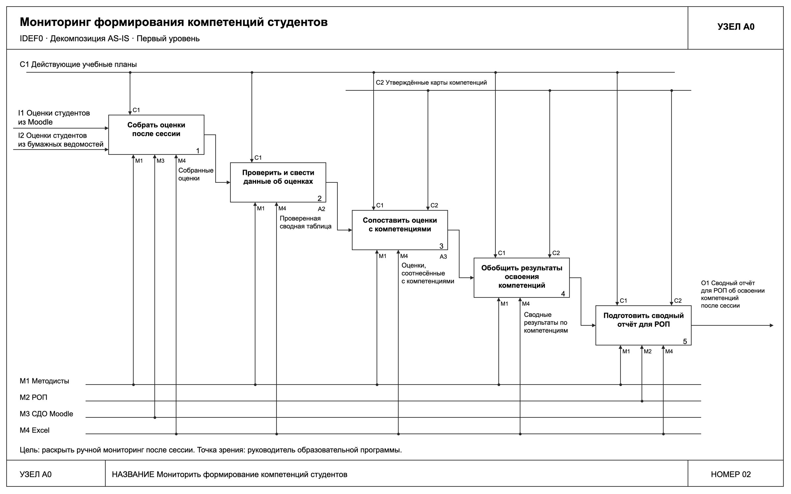
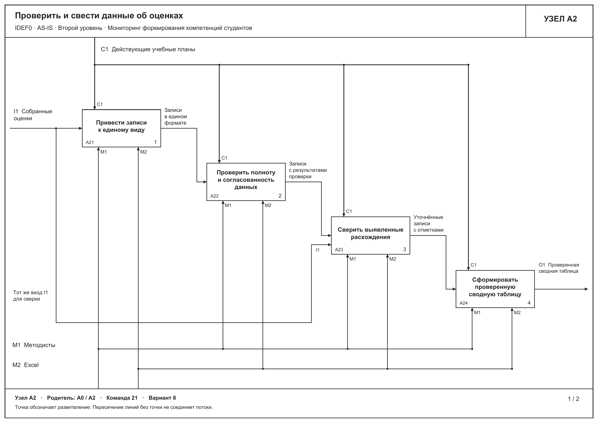
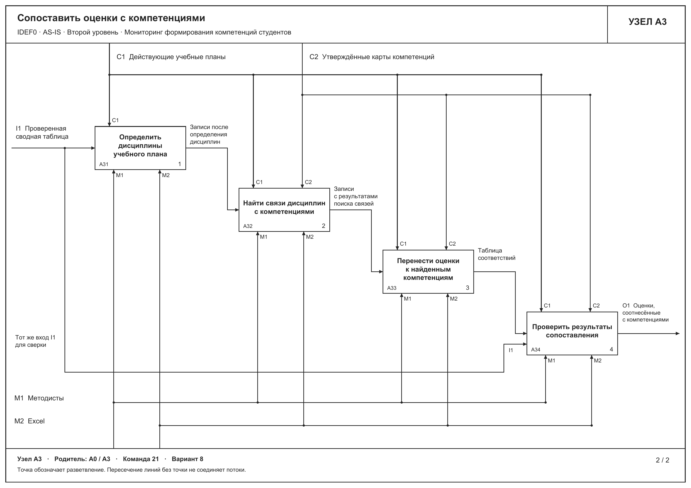
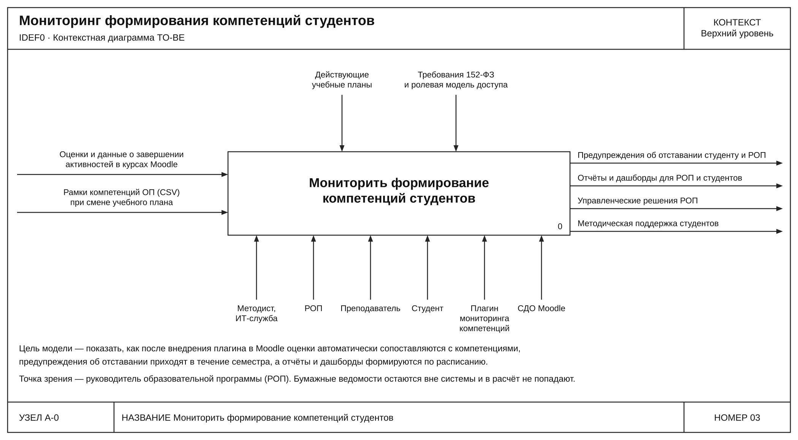
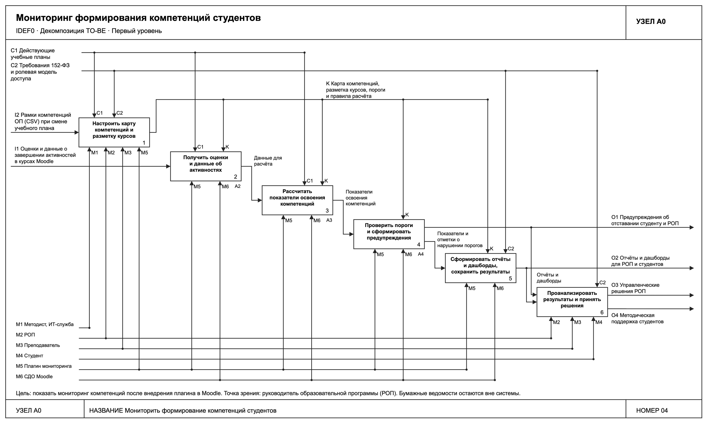
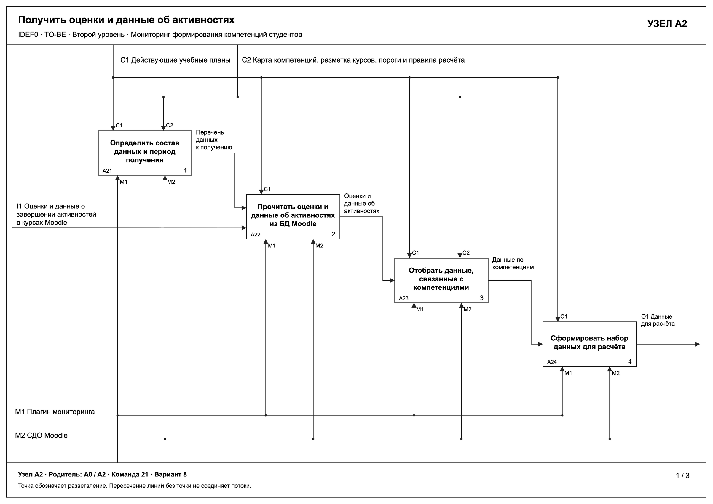
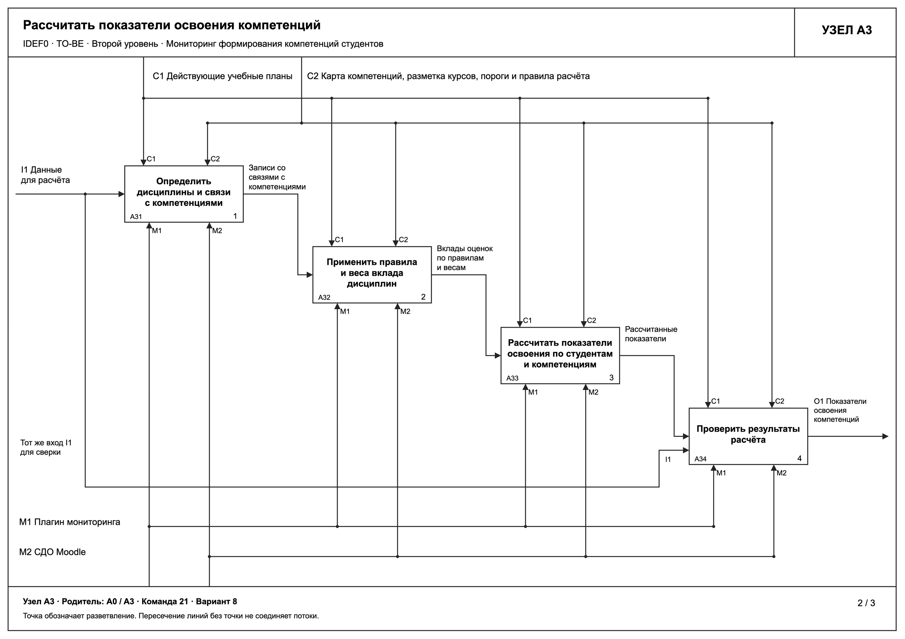
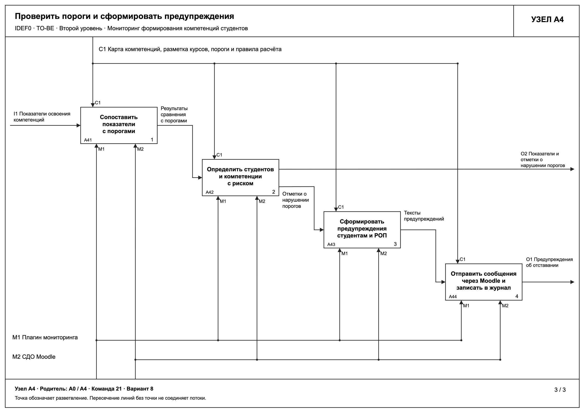

# Модель бизнес-процессов

**Практическая работа № 3 "Разработка модели бизнес-процессов с учётом внедрения информационной системы"**

Дисциплина - "Проектирование информационных систем".

**Вариант 8. Мониторинг формирования компетенций студентов**

| Реквизит                                      | Значение                               |
| ----------------------------------------------------- | ---------------------------------------------- |
| Образовательная организация | Университет ИТМО                |
| Преподаватель                            | Бондарев Юрий Алексеевич |
| Группы                                          | К3339, К3341                                 |
| Город, год                                    | Санкт-Петербург, 2026            |

## Состав команды

| Участник                     | Группа |
| ------------------------------------ | ------------ |
| Артемов Илья              | К3341       |
| Иванова Аайа              | К3341       |
| Орельский Никита      | К3339       |
| Бен Шамех Абделазиз | К3339       |
| Юшков Андрей              | К3339       |

**Цель работы** - определить, как изменится процесс мониторинга формирования компетенций студентов после внедрения информационной системы.

Исходные данные взяты из работы 2. В ней выбран вариант C - плагин мониторинга компетенций в действующей СДО Moodle. [Отчёт по работе 2](../lab2/report.md)

# 1. Контекстная диаграмма AS-IS

Модель описывает ручной мониторинг компетенций после сессии с точки зрения руководителя образовательной программы (РОП). Контекстная диаграмма A-0 содержит один функциональный блок "Мониторить формирование компетенций студентов".

_Рисунок 1.1. Контекстная диаграмма A-0 AS-IS_

| Вид связи    | Стрелки                                                                                                 |
| -------------------- | -------------------------------------------------------------------------------------------------------------- |
| Вход             | Оценки студентов из Moodle и бумажных ведомостей                           |
| Управление | Действующие учебные планы и утверждённые карты компетенций |
| Выход           | Сводный отчёт для РОП об освоении компетенций после сессии   |
| Механизм     | Методисты, РОП, СДО Moodle и Excel                                                             |

# 2. Декомпозиция бизнес-процесса AS-IS на первом уровне

Диаграмма A0 показывает, как после сессии собирают и проверяют оценки, сопоставляют их с компетенциями, обобщают результаты и готовят сводный отчёт для РОП.

_Рисунок 2.1. Декомпозиция A0 AS-IS_

# 3. Декомпозиция бизнес-процесса AS-IS на втором уровне

На втором уровне детализированы блоки A2 "Проверить и свести данные об оценках" и A3 "Сопоставить оценки с компетенциями" диаграммы A0. Эти функции выполняются после сессии и охватывают подготовку сводных данных и ручное сопоставление оценок с картой компетенций. Для обеих диаграмм использована нотация IDEF0. Точка зрения модели сохраняется, процесс рассматривается со стороны руководителя образовательной программы.

## 3.1. Проверка и сведение данных об оценках

_Рисунок 3.1. Декомпозиция A2 "Проверить и свести данные об оценках"_

На вход A2 поступают собранные в A1 оценки из Moodle и бумажных ведомостей. Методист приводит записи к единому виду, проверяет их по действующему учебному плану и собирает сводную таблицу в Excel. Внутри функции выделены четыре подфункции.

| Узел | Подфункция                                                             | Содержание работы                                                                                                                                                                                                                                                                                                                              |
| -------- | -------------------------------------------------------------------------------- | -------------------------------------------------------------------------------------------------------------------------------------------------------------------------------------------------------------------------------------------------------------------------------------------------------------------------------------------------------------- |
| A21      | Привести записи к единому виду                         | Согласовать обозначения студентов, дисциплин и учебного периода в собранных записях. Сохранить исходные значения оценок и возможность сверки с источником.                                                                |
| A22      | Проверить полноту и согласованность данных | Найти пропуски в оценках по дисциплинам учебного плана, повторяющиеся записи и противоречия между полученными данными. Передать весь набор записей вместе с результатами проверки.                    |
| A23      | Сверить выявленные расхождения                       | Сравнить отмеченные записи с уже собранными исходными оценками. Исправить подтвержденные ошибки переноса. Отметить расхождения и пропуски, которые не удалось устранить по имеющимся данным. |
| A24      | Сформировать проверенную сводную таблицу    | Объединить уточненные записи, сохранить отметки о неустраненных расхождениях и передать сводную таблицу для сопоставления с компетенциями.                                                                                            |

Исходные оценки дополнительно поступают в A23 по ответвлению входной стрелки. Это позволяет сверять подготовленные записи с полученными данными. Повторный сбор оценок относится к A1 и в данной декомпозиции не рассматривается.

Выход A2 сохраняет название "Проверенная сводная таблица". Проверенная таблица содержит результат проверки и может включать отмеченные пропуски. Отсутствующую оценку не заменяют нулем, противоречащие друг другу значения не выбирают произвольно. Если исходных сведений недостаточно, это ограничение сохраняют в таблице для дальнейшей работы.

## 3.2. Сопоставление оценок с компетенциями

_Рисунок 3.2. Декомпозиция A3 "Сопоставить оценки с компетенциями"_

На вход A3 поступает проверенная сводная таблица. Методист определяет дисциплины по действующему учебному плану, находит их связи с компетенциями в утвержденной карте и вручную заполняет таблицу соответствий в Excel.

| Узел | Подфункция                                                           | Содержание работы                                                                                                                                                                                                                                                                                                                                                                                                                                                                    |
| -------- | ------------------------------------------------------------------------------ | ---------------------------------------------------------------------------------------------------------------------------------------------------------------------------------------------------------------------------------------------------------------------------------------------------------------------------------------------------------------------------------------------------------------------------------------------------------------------------------------------------- |
| A31      | Определить дисциплины учебного плана          | Соотнести записи сводной таблицы с дисциплинами и периодом обучения в действующем учебном плане. Сохранить оценки и отметки о проблемных записях.                                                                                                                                                                                                                        |
| A32      | Найти связи дисциплин с компетенциями         | Для каждой найденной дисциплины определить связанные компетенции по утвержденной карте. Если связь в карте отсутствует или неоднозначна, сохранить отметку для проверки.                                                                                                                                                                            |
| A33      | Перенести оценки к найденным компетенциям | Заполнить строки соответствий "студент, дисциплина, оценка, компетенция". Если дисциплина связана с несколькими компетенциями, отразить каждую связь с сохранением исходной оценки. Записи без найденной связи и прежние отметки о пропусках и расхождениях сохранить. |
| A34      | Проверить результаты сопоставления             | Сверить таблицу соответствий с исходным сводом, учебным планом и картой компетенций. Проверить полноту связей и сохранность оценок. Исправить обнаруженные ошибки переноса и сохранить отметки о неустраненных проблемах.                                                                                 |

Результат A3 представляет собой оценки, соотнесенные с компетенциями. Он передается в A4 "Обобщить результаты освоения компетенций".

# 4. Модель бизнес-процесса TO-BE после внедрения информационной системы

Построены контекстная диаграмма A-0, диаграмма первого уровня A0 и декомпозиции блоков A2, A3 и A4.

## 4.1. Контекстная диаграмма A-0

_Рисунок 4.1. Контекстная диаграмма TO-BE, функция "Мониторить формирование компетенций студентов"_

| Вид связи    | Стрелка                                                                                                                                                                                                                                                              |
| -------------------- | --------------------------------------------------------------------------------------------------------------------------------------------------------------------------------------------------------------------------------------------------------------------------- |
| Вход             | Оценки и данные о завершении активностей в курсах Moodle, рамки компетенций образовательной программы (CSV) при смене учебного плана                                 |
| Управление | Действующие учебные планы, требования 152-ФЗ и ролевая модель доступа                                                                                                                                               |
| Выход           | Предупреждения об отставании студенту и РОП, отчёты и дашборды для РОП и студентов, управленческие решения РОП, методическая поддержка студентов |
| Механизм     | Методист и ИТ-служба, РОП, преподаватель, студент, плагин мониторинга компетенций и СДО Moodle                                                                                                      |

Карта компетенций формируется внутри процесса. Отчёты, дашборды и предупреждения доступны в течение семестра по результатам расчётов по расписанию.

## 4.2. Декомпозиция первого уровня A0

_Рисунок 4.2. Декомпозиция A0 TO-BE_

| Блок | Функция                                                                                     | Содержание работы                                                                                                                                                                                                                                                                                                                                                                            |
| -------- | -------------------------------------------------------------------------------------------------- | ------------------------------------------------------------------------------------------------------------------------------------------------------------------------------------------------------------------------------------------------------------------------------------------------------------------------------------------------------------------------------------------------------------ |
| A1       | Настроить карту компетенций и разметку курсов              | Методист или ИТ-служба загружает рамки компетенций из CSV. РОП формирует карту, задаёт пороги и правила расчёта, плагин сохраняет версию и запись в журнале. Преподаватель размечает активности курсов Moodle компетенциями |
| A2       | Получить оценки и данные об активностях                          | Плагин по расписанию читает оценки и данные о завершении активностей из Moodle без выгрузок                                                                                                                                                                                                                                          |
| A3       | Рассчитать показатели освоения компетенций                  | Плагин связывает оценки с компетенциями и рассчитывает показатели по единым правилам и весам                                                                                                                                                                                                                                 |
| A4       | Проверить пороги и сформировать предупреждения           | Показатели сравниваются с порогами, при нарушении студент и РОП получают сообщение Moodle                                                                                                                                                                                                                                             |
| A5       | Сформировать отчёты и дашборды, сохранить результаты | Отчёты по студентам, компетенциям, программе и когортам, дашборд студента. Результаты и журнал хранятся в БД Moodle                                                                                                                                                                                                |
| A6       | Проанализировать результаты и принять решения             | РОП анализирует отчёты и предупреждения и принимает решения. Студент просматривает свой прогресс и полученные сообщения. При необходимости преподаватель оказывает методическую поддержку                                                 |

Поток K "Карта компетенций, разметка курсов, пороги и правила расчёта" выходит из A1 и управляет блоками A2-A5. Из A2 в A3 поступают данные для расчёта, а из A3 в A4 - рассчитанные показатели освоения. A4 передаёт в A5 показатели с отметками о нарушении порогов. В A6 поступают предупреждения из A4 и отчёты с дашбордами из A5. Эти два потока также выходят на границу модели как O1 и O2 соответственно.

В TO-BE блок A2 охватывает сбор и подготовку данных, которым в AS-IS соответствуют A1 и A2. Блок A3 объединяет сопоставление и обобщение результатов из A3 и A4 модели AS-IS. Подготовка отчётности автоматизирована в A5. Дочерние диаграммы указаны под блоками A2, A3 и A4.

## 4.3. Декомпозиция A2 "Получить оценки и данные об активностях"

_Рисунок 4.3. Декомпозиция A2 TO-BE_

| Узел | Подфункция                                                                         | Содержание работы                                                                                                                                                                                                                                               |
| -------- | -------------------------------------------------------------------------------------------- | ------------------------------------------------------------------------------------------------------------------------------------------------------------------------------------------------------------------------------------------------------------------------------- |
| A21      | Определить состав данных и период получения            | По расписанию и действующему учебному плану определить студентов, дисциплины и учебный период                                                                                                  |
| A22      | Прочитать оценки и данные об активностях из БД Moodle | Прочитать оценки и данные о завершении активностей внутри Moodle, без выгрузок и ручного переноса                                                                                                  |
| A23      | Отобрать данные, связанные с компетенциями              | По разметке из A1 отобрать активности и элементы оценивания, связанные с компетенциями. Данные без разметки отметить                                                           |
| A24      | Сформировать набор данных для расчёта                       | Привести записи к виду "студент, дисциплина, активность, оценка" с сохранением исходных значений. Отсутствующую оценку не заменять нулём, а отметить |

Вход I1 содержит оценки и данные о завершении активностей. Управления C1 и C2 соответствуют учебным планам и потоку K на A0. Механизмы M1 и M2 соответствуют плагину и СДО Moodle (M5 и M6 на A0). Выход O1 "Данные для расчёта" поступает в A3.

## 4.4. Декомпозиция A3 "Рассчитать показатели освоения компетенций"

_Рисунок 4.4. Декомпозиция A3 TO-BE_

| Узел | Подфункция                                                                                           | Содержание работы                                                                                                                                                                                                                                                              |
| -------- | -------------------------------------------------------------------------------------------------------------- | ---------------------------------------------------------------------------------------------------------------------------------------------------------------------------------------------------------------------------------------------------------------------------------------------- |
| A31      | Определить дисциплины и связи с компетенциями                          | По разметке курсов и карте найти компетенции, связанные с каждой записью. Записи без связи отметить                                                                                                         |
| A32      | Применить правила и веса вклада дисциплин                                  | Определить вклад оценки в компетенцию по единым правилам и весам, заданным РОП                                                                                                                                               |
| A33      | Рассчитать показатели освоения по студентам и компетенциям | Агрегировать вклады в показатель освоения каждой компетенции студента                                                                                                                                                            |
| A34      | Проверить результаты расчёта                                                         | Автоматически сверить результат с исходными данными (вход I1 для сверки), проверить полноту связей и сохранность оценок, сохранить отметки о неполных данных |

Вход I1 "Данные для расчёта" поступает из A2. Управления C1 и C2 соответствуют учебным планам и потоку K на A0, механизмы M1 и M2 - плагину и СДО Moodle. Выход O1 "Показатели освоения компетенций" поступает в A4.

## 4.5. Декомпозиция A4 "Проверить пороги и сформировать предупреждения"

_Рисунок 4.5. Декомпозиция A4 TO-BE_

| Узел | Подфункция                                                                        | Содержание работы                                                                                                                               |
| -------- | ------------------------------------------------------------------------------------------- | --------------------------------------------------------------------------------------------------------------------------------------------------------------- |
| A41      | Сопоставить показатели с порогами                             | Сравнить показатель каждой компетенции студента с порогом из карты                                    |
| A42      | Определить студентов и компетенции с риском           | Отметить нарушения порогов. Показатели с отметками уходят в A5                                               |
| A43      | Сформировать предупреждения студентам и РОП          | Подготовить текст с указанием компетенции, рассчитанного значения и порога                     |
| A44      | Отправить сообщения через Moodle и записать в журнал | Отправить штатные сообщения Moodle после очередного расчёта и записать действие в журнал |

Вход I1 "Показатели освоения компетенций" поступает из A3. Управление C1 соответствует потоку K на A0, механизмы M1 и M2 - плагину и СДО Moodle. Выход O1 "Предупреждения об отставании" ветвится на A0 к блоку A6 и к границе модели. Выход O2 "Показатели и отметки о нарушении порогов" поступает в A5.

# 5. Пояснения к диаграммам

## 5.1. A-0 (AS-IS)

Граница процесса проходит от получения оценок из Moodle и бумажных ведомостей до подготовки сводного отчёта для РОП. Для сопоставления оценок с компетенциями методисты используют утверждённые карты и учебные планы.

## 5.2. A0 (AS-IS, первый уровень)

Оценки из Moodle и бумажных ведомостей собирают в A1 и сводят в A2. Методисты вручную обрабатывают данные в Excel, а РОП участвует в подготовке отчёта в A5. Ручное сведение и сопоставление оценок создают риск ошибок переноса.

## 5.3. A2 (AS-IS, второй уровень)

В A23 методист сверяет выявленные расхождения с уже собранными оценками. Сводная таблица сохраняет отметки о пропусках и расхождениях, которые не удалось устранить.

## 5.4. A3 (AS-IS, второй уровень)

Утверждённая карта задаёт связи между дисциплинами и компетенциями. В A34 методист сверяет заполненную таблицу с исходным сводом, после чего передаёт оценки, соотнесённые с компетенциями, для обобщения в A4.

## 5.5. A-0 (TO-BE)

Moodle становится единственным источником оценок для расчёта. Рамки компетенций поступают отдельным входом в CSV. Бумажные ведомости по-прежнему заполняются вне системы, а мониторинг в Moodle ведётся в течение семестра.

## 5.6. A0 (TO-BE, первый уровень)

Карта, разметка курсов, пороги и правила расчёта из A1 управляют автоматическими функциями A2-A5. В A6 РОП принимает решения по отчётам и предупреждениям. Студент просматривает свой прогресс и сообщения, а преподаватель при необходимости оказывает методическую поддержку.

## 5.7. A2 (TO-BE, второй уровень)

Плагин читает оценки и сведения о завершении активностей из Moodle по расписанию. Разметка курсов определяет, какие записи попадут в набор для расчёта. Пропуски и отсутствие разметки отмечаются при подготовке данных.

## 5.8. A3 (TO-BE, второй уровень)

Плагин определяет вклад оценок по заданным весам и рассчитывает показатель для каждой пары "студент - компетенция". В A34 он проверяет результат по исходному набору данных и сохраняет отметки о неполных данных.

## 5.9. A4 (TO-BE, второй уровень)

Плагин сравнивает показатели с порогами после очередного расчёта. При нарушении порога он отправляет предупреждение студенту и РОП через Moodle и записывает действие в журнал. Показатели с отметками передаются в A5 для отчётности.

# 6. Основные различия в бизнес-процессах до и после внедрения информационной системы

| Что сравниваем                                                    | До внедрения (AS-IS)                                                                                                                                                                                                                                                                                                  | После внедрения (TO-BE)                                                                                                                                                                                                                                                                                                                                                                                                                                                                                       |
| ------------------------------------------------------------------------------ | -------------------------------------------------------------------------------------------------------------------------------------------------------------------------------------------------------------------------------------------------------------------------------------------------------------------------------- | --------------------------------------------------------------------------------------------------------------------------------------------------------------------------------------------------------------------------------------------------------------------------------------------------------------------------------------------------------------------------------------------------------------------------------------------------------------------------------------------------------------------------- |
| Сбор и подготовка данных                                  | После сессии методисты собирают оценки из Moodle и бумажных ведомостей, сверяют расхождения и составляют сводную таблицу в Excel (A1-A2).                                                                                     | Плагин по расписанию читает из Moodle оценки и сведения о завершении активностей, отбирает записи, связанные с компетенциями, и готовит набор данных для расчёта (A2). Бумажные ведомости заполняются вручную вне системы. Оценки, которые есть только в ведомостях, в расчёт не попадают. |
| Карта компетенций и настройка процесса       | Методисты используют действующие учебные планы и уже утверждённые карты компетенций. При смене учебного плана история карт теряется.                                                                           | При смене плана методист или ИТ-служба загружает рамки компетенций из CSV. РОП формирует карту и задаёт пороги, правила и веса. Преподаватели размечают активности в курсах Moodle, а плагин сохраняет версии карты (A1).                                                                                                                            |
| Сопоставление оценок и расчёт показателей | Методисты вручную сопоставляют оценки с компетенциями и обобщают результаты в Excel (A3-A4). Единых правил расчёта вклада дисциплин нет.                                                                                | Плагин связывает оценки с компетенциями по разметке курсов и рассчитывает показатели по каждому студенту и компетенции с учётом правил и весов, заданных РОП (A3).                                                                                                                                                                                                                     |
| Выявление отставания                                        | РОП узнаёт о проблемах по сводному отчёту после сессии. Автоматических предупреждений нет (A5).                                                                                                                                                     | В течение семестра плагин сравнивает показатели с порогами. При нарушении порога студент и РОП получают сообщение Moodle после очередного расчёта (A4).                                                                                                                                                                                                                                              |
| Отчётность и работа с результатами               | Методисты и РОП вручную готовят сводный отчёт после сессии (A5). Студенты видят оценки по дисциплинам.                                                                                                                                         | Плагин формирует отчёты и дашборды (A5). РОП анализирует отчёты и предупреждения, сравнивает когорты и принимает решения. Студент видит свой прогресс и полученные сообщения. При необходимости преподаватель оказывает методическую поддержку (A6).                                                              |
| Хранение данных и доступ                                  | Для подготовки сводки используются локальные файлы с оценками и персональными данными. Файлы пересылаются по почте без централизованного контроля доступа и журналирования. | Результаты мониторинга и журнал действий хранятся в базе Moodle. Доступ к данным разграничен по ролям (A5-A6).                                                                                                                                                                                                                                                                                                                              |
