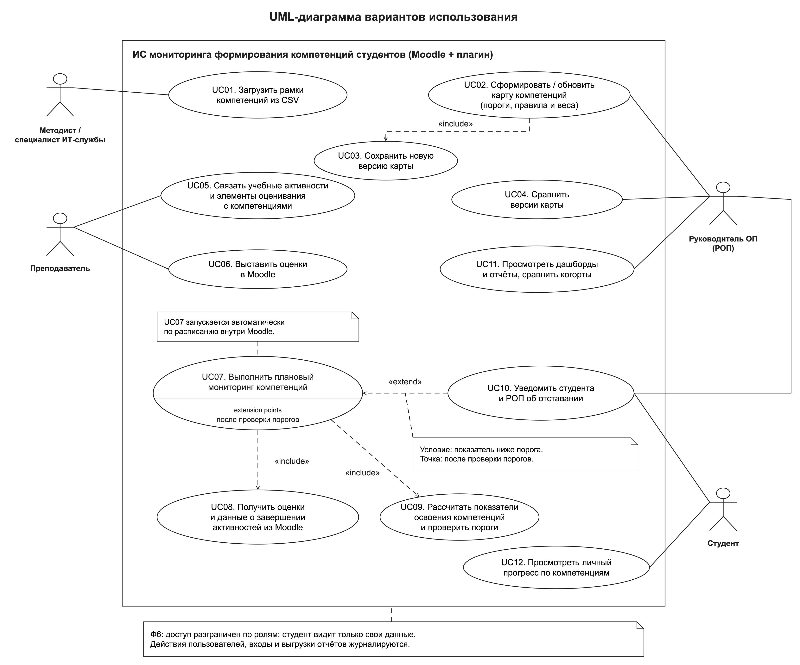

# UML-диаграмма вариантов использования

**Практическая работа № 4. Пункт 1**

**Вариант 8. Мониторинг формирования компетенций студентов**

**Исполнитель:** Артемов Илья, К3341.

> На основе требований, сформулированных в работе 2, построить UML-диаграмму вариантов использования для разрабатываемой информационной системы.

## 1. Граница системы

Диаграмма построена для варианта C, выбранного в [работе 2](../lab2/report.md): существующая СДО Moodle, её штатная подсистема Competencies и плагин мониторинга. В границу включены функции Moodle, непосредственно участвующие в мониторинге: загрузка рамок компетенций, разметка активностей, выставление оценок и отправка сообщений. Поэтому Moodle, её база данных и внутренний планировщик не показаны внешними акторами.

Основание модели: требования Ф1-Ф6 из раздела 1.3, выбранная концепция из раздела 4.7, целевой процесс и границы автоматизации из разделов 5.1-5.5, показатели приёмки из раздела 8.1 работы 2.

## 2. Диаграмма

*Рисунок 1. UML-диаграмма вариантов использования разрабатываемой информационной системы.*

[Редактируемая диаграмма для draw.io](use_case_diagram.drawio).

## 3. Акторы и варианты использования

| Актор | Участие в работе системы |
| --- | --- |
| Методист / специалист ИТ-службы | Загружает рамки компетенций образовательной программы из CSV (UC01). Это одна роль подготовки данных, которую по разделу 5.1 работы 2 выполняет методист или сотрудник ИТ-службы. |
| Преподаватель | Связывает учебные активности и элементы оценивания с компетенциями (UC05), выставляет оценки в Moodle (UC06). |
| Руководитель образовательной программы (РОП) | Формирует или обновляет карту компетенций, задаёт пороги, правила и веса расчёта (UC02), сравнивает версии карты (UC04), просматривает дашборды и отчёты, сравнивает когорты (UC11), получает предупреждения (UC10). |
| Студент | Просматривает личный прогресс по компетенциям с привязкой к дисциплинам (UC12), получает предупреждения (UC10). |

Плановый мониторинг UC07 запускается автоматически внутри Moodle. Он получает оценки и сведения о завершении активностей (UC08), рассчитывает показатели по правилам и весам РОП, проверяет пороги (UC09) и сохраняет результаты для последующего просмотра. Пользователь не запускает этот расчёт вручную. Ассоциации студента и РОП с UC10 показывают их участие как получателей предупреждений.

## 4. Связи и соответствие требованиям

Связи **«include»** направлены от основного варианта к обязательному включаемому поведению: UC02 включает сохранение новой версии карты (UC03), а UC07 включает получение данных (UC08) и расчёт с проверкой порогов (UC09). Прежние версии карты остаются доступными.

Связь **«extend»** направлена от уведомления UC10 к мониторингу UC07. Точка расширения - «после проверки порогов», условие - рассчитанный показатель ниже установленного порога. При выполнении условия система отправляет предупреждение студенту и РОП через штатные сообщения Moodle. Если нарушений нет, мониторинг завершается без предупреждений. Пунктирные связи с примечаниями поясняют условия и ограничения, а сплошные линии между акторами и вариантами использования обозначают участие.

| Требование работы 2 | Отражение в модели |
| --- | --- |
| Ф1. Автоматическое получение оценок и данных о завершении активностей | UC07 включает UC08. Для выбранного варианта C данные читаются внутри Moodle без ручных выгрузок и внешней интеграции, как уточнено в разделе 5 работы 2. |
| Ф2. Ведение и версионирование карты компетенций | UC02, обязательное сохранение новой версии UC03 и сравнение версий UC04. |
| Ф3. Дашборды, аналитические отчёты и пороги | UC11 охватывает отчёты по студентам, группам, курсам, дисциплинам и программе, а также сравнение когорт. Пороги задаются в UC02 и проверяются в UC09. |
| Ф4. Личный прогресс студента | UC12 показывает освоение компетенций с привязкой к дисциплинам. |
| Ф5. Предупреждения студенту и РОП | Условное расширение UC10 после очередного планового расчёта. |
| Ф6. Доступ по ролям и журналирование | Ассоциации задают участие ролей; общее ограничение требует проверки прав при выполнении операций и журналирования действий. Студенту доступны только его данные. Входы и выгрузки отчётов фиксируются в журнале согласно разделу 8.1 работы 2. |

Бумажные ведомости, ручное оформление документов для самообследования и оказание преподавателем методической поддержки находятся вне границы системы. Нагрузочные, мобильные, инфраструктурные и ресурсные требования работы 2 сохраняются как ограничения реализации и не выделяются в самостоятельные варианты использования.

При выборе нотации учтены материалы преподавателя: «UML.pdf» и связанные с ним [слайды «UML - язык графического моделирования»](https://disk.yandex.ru/i/z5dRhHdUyB8rlQ), а также материалы по IDEF0 и моделированию бизнес-процессов. Обозначения акторов, вариантов использования и связей соответствуют разделу 18 [спецификации UML 2.5.1](https://www.omg.org/spec/UML/2.5.1/PDF).
