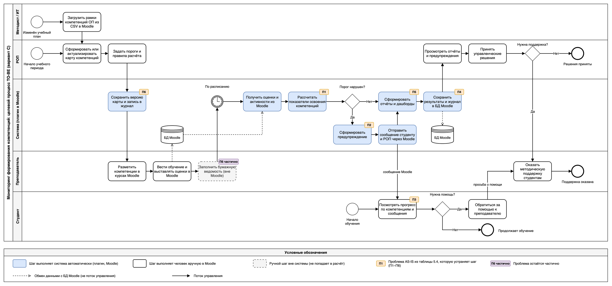

# Концепция информационной системы

**Практическая работа «Разработка концепции информационной системы»**

Дисциплина: «Проектирование информационных систем»

Стадия жизненного цикла: 2 «Разработка концепции АС» по ГОСТ Р 59793-2021

**Вариант 8. Мониторинг формирования компетенций студентов**

| Реквизит | Значение |
| --- | --- |
| Образовательная организация | Университет ИТМО |
| Преподаватель | Бондарев Юрий Алексеевич |
| Группы | К3339, К3341 |
| Дата сдачи | 28.10.2026 |
| Город, год | Санкт-Петербург, 2026 |

## Состав команды и распределение ролей

Роли распределены по методическим указаниям (п. 3.3), один участник совмещает несколько ролей.

| Участник | Группа | Роль на стадии концепции | Ответственный за |
| --- | --- | --- | --- |
| Артемов Илья | К3341 | Руководитель проекта; заказчик (согласование критериев и весов, принятые условия Д1–Д5); представители пользователей | Титульный лист, раздел 6, подраздел 5.6, раздел 9, список источников, сборка отчёта |
| Иванова Аайа | К3341 | Бизнес-аналитик | Разделы 1 и 5 (требования, модель TO-BE) |
| Орельский Никита | К3339 | Системный аналитик | Разделы 2 и 4 (обзор аналогов, сравнение и выбор варианта) |
| Бен Шамех Абделазиз | К3339 | Архитектор | Раздел 3 (альтернативные варианты концепции) |
| Юшков Андрей | К3339 | Специалист по ИБ, контроль качества | Разделы 7 и 8 (риски, показатели приёмки) |

# 1. Характеристика объекта автоматизации и требования пользователя

## 1.1. Описание объекта и участников
**Объект автоматизации:** Процесс мониторинга формирования компетенций студентов в рамках образовательных программ (ОП) университета.

**Участники процесса:**
- **Студенты:** осваивают дисциплины, заинтересованы в прозрачности своего прогресса.
- **Преподаватели:** ведут курсы в СДО, выставляют оценки, формируют компетенции своими дисциплинами.
- **Руководители образовательных программ (РОП):** утверждают карты компетенций, оценивают, насколько хорошо студенты осваивают программу, и формируют по этим данным итоговые отчеты.
- **Методисты и ИТ-служба:** обеспечивают поддержку данных, учебных планов и работу смежных систем.

## 1.2. Основные проблемы текущего процесса (AS-IS)
На основе обследования выделены 6 ключевых проблем:
1. **Ручной труд и высокий риск ошибок:** Сопоставление оценок с компетенциями выполняется методистами вручную в Excel после сессии, что занимает много времени и приводит к ошибкам.
2. **Запоздалая реакция на проблемы:** РОП получает сводные данные только после сессии, когда оперативно повлиять на учебный процесс уже невозможно.
3. **Отсутствие прозрачности для студентов:** Студенты видят только оценки по дисциплинам, но не понимают, какие именно профессиональные навыки и компетенции они осваивают, и не получают предупреждений об отставании.
4. **Разрозненность данных и риски ИБ:** Файлы с персональными данными и оценками хранятся на личных ПК и пересылаются по почте без контроля доступа и журналирования.
5. **Отсутствие единой аналитической картины:** Нет инструмента, позволяющего РОП в реальном времени видеть сводку по группам, дисциплинам и компетенциям, а также сравнивать когорты.
6. **Потеря истории и дублирование ввода:** При смене учебного плана старые карты компетенций теряются. Преподавателям приходится вводить данные в Moodle и в бумажные ведомости, при этом единых правил расчета вклада дисциплины в компетенцию нет.

## 1.3. Требования пользователя

### Функциональные требования
- **Ф1.** Автоматический импорт оценок и данных о завершении активностей из СДО Moodle через веб-сервисы (без ручного ввода).
- **Ф2.** Ведение и версионирование карты компетенций ОП (возможность для РОП создавать новые версии при смене плана и сравнивать их).
- **Ф3.** Формирование дашбордов и аналитических отчетов для РОП (сводка по группам, курсам, дисциплинам, настройка пороговых значений, сравнение когорт).
- **Ф4.** Отображение студенту личного прогресса по компетенциям с привязкой к конкретным дисциплинам в понятном виде.
- **Ф5.** Система автоматических предупреждений для студента и РОП при риске неосвоения компетенции.
- **Ф6.** Строгая ролевая модель доступа (студент видит только свои данные) и обязательное журналирование действий пользователей.

### Нефункциональные требования
- **Н1.** Поддержка пиковой нагрузки до 300 одновременных пользователей (в период сессии) со временем отклика интерфейса не более 2 секунд.
- **Н2.** Наличие адаптивного мобильного интерфейса для удобства студентов.
- **Н3.** Интеграция должна осуществляться без замены текущей СДО Moodle, используя её штатные механизмы (веб-сервисы).

### Ограничения 
- **О1.** Размещение всех данных и серверов исключительно на территории РФ.
- **О2.** Бюджет создания системы: не более 3 000 тыс. руб.
- **О3.** Срок ввода в эксплуатацию: не более 9 месяцев.

## 1.4. Обязательные требования
Варианты концепции, не удовлетворяющие следующим требованиям, исключаются из рассмотрения на этапе сравнения:
1. **М1.** Строгое соблюдение 152-ФЗ (хранение персональных данных на серверах в РФ). 
2. **М2.** Сохранение текущей СДО Moodle и наличие технической возможности интеграции с ней.
3. **М3.** Автоматизация сбора данных об оценках из Moodle.

## 1.5. Условия заказчика

Условия не заданы преподавателем, поэтому приняты следующие допущения. На них ссылаются разделы 2–8.

| № | Условие | Значение | Соответствует в 1.3 и 1.4 |
| --- | --- | --- | --- |
| Д1 | Число пользователей | Один институт: 2000 студентов, 150 преподавателей, 10 руководителей образовательных программ (РОП), до 300 одновременных пользователей в пике | Н1 |
| Д2 | Бюджет создания | Не более 3 000 тыс. руб., включая резерв 15 % | О2 |
| Д3 | Срок ввода | Не более 9 месяцев, включая пилот на одной ОП | О3 |
| Д4 | Размещение данных | Только на серверах в РФ (152-ФЗ, ст. 18 ч. 5) | О1, М1 |
| Д5 | Смежная система | В институте работает СДО Moodle (доступ к данным через веб-сервисы), замена СДО не планируется | М2, Н3 |

## 1.6. Связь требований с проблемами AS-IS

| Проблема AS-IS (п. 1.2) | Требования, которые её закрывают |
| --- | --- |
| 1. Ручной труд и высокий риск ошибок | Ф1, Ф3, М3 |
| 2. Запоздалая реакция на проблемы | Ф3, Ф5 |
| 3. Отсутствие прозрачности для студентов | Ф4, Ф5, Н2 |
| 4. Разрозненность данных и риски ИБ | Ф6, О1, М1 |
| 5. Отсутствие единой аналитической картины | Ф3, Н1 |
| 6. Потеря истории и дублирование ввода | Ф1, Ф2 |
| Условия, не связанные с отдельной проблемой | Н3, О2, О3, М2 |

# 2. Аналитический обзор аналогов и готовых решений

Для обзора отобраны пять решений, которые закрывают типовые пути автоматизации из методички. Три отечественные системы класса «управление вузом» (Modeus, 1С:Университет ПРОФ, ТАНДЕМ.Университет) показывают, что дает готовое решение. Встроенная подсистема компетенций СДО Moodle показывает, что можно получить доработкой системы, которая уже работает в институте (условие Д5). Зарубежная Canvas LMS с подсистемой Outcomes взята как ориентир по функциям мониторинга результатов обучения и как проверка условия Д4 о размещении данных. Сравнение ведется по единым критериям, в их числе функции по теме варианта (карта компетенций, привязка к дисциплинам и оценкам, дашборды), интеграция со смежными системами, модель лицензирования и стоимость, размещение данных. Отдельно оценено покрытие требований пользователя из раздела 1. Сведения взяты с официальных страниц вендоров и документации по состоянию на 26.10.2026, номера в квадратных скобках отсылают к общему списку источников в конце отчёта.

## 2.1. Сравнение аналогов

Решения сравниваются по функциям по теме варианта, лицензированию и стоимости, интеграции с Moodle и размещению данных. Подробные таблицы с функциями, интеграцией, лицензированием и размещением даны в приложении А.

| Решение | Функции по теме | Лицензия и стоимость | Интеграция с Moodle | Размещение данных (Д4) |
| --- | --- | --- | --- | --- |
| Modeus (CUSTIS) | Модель компетенций, учебные планы и успеваемость, рейтинги. Расчёт компетенций из оценок и дашборды по компетенциям публично не описаны [2, 3] | Простая неисключительная лицензия, цена не раскрывается (коммерческая тайна) [1] | Заявлены простая интеграция и совместимость с LMS, механизм и Moodle не описаны, API и импорт-экспорт отмечены как отсутствующие [2, 3] | SaaS, площадка не названа, нужно подтверждение вендора [2] |
| 1С:Университет ПРОФ | Учебные планы по ФГОС ВО, учёт успеваемости и ведомостей, проектирование РПД. Связь оценки с компетенцией и дашборды по компетенциям не заявлены [4, 6] | Конфигурация 282 700 ₽, обновления 364 000 ₽ в год, продажа через франчайзи, состав поставки по платформе уточняется [5] | Штатного модуля для Moodle нет, обмен силами интегратора через web-сервисы, HTTP-сервисы, OData [4, 6, 7] | Размещение на странице не указано, Д4 выполняется при установке на серверах института [4] |
| ТАНДЕМ.Университет | Учебные планы и их версии, импорт компетенций из ИМЦА и GosInsp, оценки в модулях «Сессия» и БРС. Расчёта компетенций из оценок и дашбордов по компетенциям нет [10, 11] | Неисключительные лицензии на модули, цена по запросу, в цену входят обучение, консультации и 12 месяцев поддержки [12] | Модуль «Интеграционная шина», готовой интеграции с Moodle в описании нет [9, 10] | На серверах вуза, возможна СУБД PostgreSQL, Д4 выполняется [9, 12] |
| Moodle, подсистема Competencies | Рамки компетенций (дерево, шкалы, CSV), привязка к курсам и активностям, правила засчитывания, отчёт по компетенциям курса, планы обучения. Статистика по когортам через плагин Monitoring of Learning Plans [13–16] | GNU GPL, 0 ₽ за лицензию, затраты на настройку, плагин и сопровождение [18] | Интеграция не нужна, подсистема работает внутри СДО, для внешних систем есть веб-сервисы REST и SOAP [17] | На серверах института, Д4 и Д5 выполняются |
| Canvas LMS, подсистема Outcomes | Результаты обучения на уровне учреждения, импорт из CSV, четыре метода расчёта освоения, отчёт Outcome Results [20, 21] | Подписка SaaS по запросу или открытый код AGPLv3 без поддержки вендора [19] | Продукт замещает СДО, что противоречит Д5, работа с оценками из Moodle не предусмотрена | Серверы AWS в Европе, Канаде и АТР, российского региона нет, Д4 не выполняется [22–24] |

## 2.2. Покрытие требований пользователя

Ф5 (предупреждения) не заявлена ни у одного из решений. Ф3 (дашборды с порогами и сравнением когорт) закрыта только частично везде. Ф1 (автоматический импорт оценок из Moodle) и Ф4 (прогресс студента) полностью закрывает только Moodle Competencies, Ф4 ещё и Canvas. Canvas не проходит обязательные М1 и М2. Таблица покрытия по каждому требованию Ф1–Ф6, Н1–Н3, М1 и М2 приведена в приложении А (подраздел А.3).

## 2.3. Выводы по обзору

Ни одно из готовых решений не закрывает задачу мониторинга компетенций целиком. Системы управления вузом (1С:Университет ПРОФ, ТАНДЕМ.Университет, Modeus) сильны в учебных планах и учете контингента, при этом по открытым описаниям они не рассчитывают компетенции из оценок, которые живут в Moodle, и не дают дашбордов по компетенциям для студента и РОП. Подсистемы внутри СДО (Moodle Competencies, Canvas Outcomes) считают освоение из активностей курса и показывают его студенту. Аналитики для руководителя программы в них мало. Сводка ограничена отчетом по студентам одного шаблона или курса, единых правил расчета с весами дисциплин нет.

Для института с условием Д5 ближайший к задаче путь дает подсистема Competencies уже имеющейся Moodle вместе с плагином мониторинга учебных планов. Он не требует лицензионных платежей, не требует интеграции и хранит данные там же, где они уже лежат. Ограничения у него есть. Расчет ведется только по активностям Moodle, оценки из ведомостей вне СДО не учитываются, нет сравнения когорт, порогов и предупреждений, нет версий карты со сравнением по годам. Этот путь передается в шаг 3 как основа варианта «доработка существующей системы».

1С:Университет ПРОФ и ТАНДЕМ.Университет годятся как кандидаты на вариант «готовое решение» только в том случае, если институт готов внедрять систему управления вузом целиком. Отдельного модуля мониторинга компетенций у них нет. У 1С стоимость лицензий известна по прайсу (1 374 700 ₽ за три года без внедрения, состав поставки по платформе уточняется у франчайзи), у ТАНДЕМ цена по запросу. В обоих случаях обмен оценками с Moodle остается заказной интеграционной работой, дашборды по компетенциям придется дорабатывать.

Modeus закрывает ИОТ и компетентностную модель как облачная платформа. Цена и площадка размещения не раскрываются, масштаб платформы при этом заметно шире задачи одного института. Без подтверждения размещения в РФ и стоимости вариант на его основе оценить нельзя.

Canvas исключается условиями Д4 и Д5. При этом он полезен как функциональный ориентир. Результаты обучения на уровне учреждения с запретом правок в курсах, импорт из CSV, несколько методов расчета освоения, отчет по всем студентам и понятный студенту вид освоения образуют набор функций, который стоит заложить в вариант собственной разработки.

Для шага 4 из обзора следует, что критерии «покрытие требований», «интеграция с Moodle» и «размещение данных» должны получить заметный вес, именно по ним готовые решения расходятся сильнее всего. Стоимость при этом у трех решений из пяти (Modeus, ТАНДЕМ.Университет, Canvas) известна только по запросу.

# 3. Альтернативные варианты концепции ИС

В разделе 2 выяснилось, что готового решения под задачу нет, а ближе всего к ней стоит подсистема компетенций в уже установленной Moodle. Исходя из этого разработано пять вариантов. Они различаются тем, где живут карта компетенций и расчёт освоения и кто это создаёт: никто (A), вендор (B), институт внутри Moodle (C), институт рядом с Moodle (D) или институт с нуля (E).

| Вариант | Путь по методичке                                                                                     |
| -------------- | -------------------------------------------------------------------------------------------------------------------- |
| A              | Организационное решение без новой ИС («нулевой» вариант)             |
| B              | Готовое коробочное решение с интеграцией                                         |
| C              | Доработка существующей системы (Moodle)                                                  |
| D              | Комбинированный: готовое ядро (Moodle Competencies) и собственный сервис |
| E              | Собственная разработка                                                                          |

Canvas LMS в варианты не вошёл: он заменяет СДО (противоречит Д5 и М2) и не имеет российского региона (Д4, М1). Modeus не вошёл, потому что цена и площадка размещения не раскрываются и оценить ресурсы нечем. Low-code платформы в обзоре не рассматривались, данных для оценки ресурсов нет, поэтому отдельным вариантом они не взяты.

## 3.1. Допущения для оценки ресурсов

Все цифры ниже ориентировочные, для сравнения вариантов между собой.

1. Стоимость одного человеко-месяца работ (аналитик, разработчик, тестировщик в среднем) принята равной 240 тыс. руб. Обзоры рынка за 2026 год дают для backend-, Python- и PHP-разработчиков зарплаты примерно от 150 до 250 тыс. руб. в месяц [25–27]. Берём 185 тыс. руб. и добавляем 30 % страховых взносов, получается около 240 тыс. руб.
2. Резерв 15 % нужен только для проверки бюджета (Д2: не более 3 000 тыс. руб. вместе с резервом). В стоимость владения за 3 года резерв не входит.
3. В затраты на эксплуатацию входят только ИТ-расходы: лицензии, хостинг, сопровождение. Время пользователей (методистов, преподавателей, РОП) сюда не включено, его оценит шаг 6.
4. Сопровождение собственного кода принято равным 20 % от стоимости создания в год.
5. Цены на 1С:Университет ПРОФ взяты из раздела 2 (282,7 тыс. руб. за поставку и 364 тыс. руб. в год за обновления). Платформу 1С:Предприятие и клиентские лицензии в раздел 2 не попали, для них заложено 350 тыс. руб. как оценка, её надо уточнить у франчайзи. Возможно, платформа уже входит в поставку (в прайс-листе есть позиция «Дополнительные лицензии на платформу» [5]), тогда стоимость создания варианта B с резервом составит около 3 637 тыс. руб. и превышение бюджета Д2 сократится с 1 040 до 637 тыс. руб., на выбор варианта это не влияет.
6. Стоимость хостинга в РФ (виртуальные машины, база данных, резервные копии) оценена командой, точных прайсов в расчёте нет.
7. Срок каждого варианта включает пилот на одной ОП (условие Д3).

## 3.2. Сводная таблица вариантов

Суммы в тыс. руб.

| Параметр | A | B | C | D | E |
| --- | --- | --- | --- | --- | --- |
| Идея решения | Таблицы и регламент | 1С:Университет ПРОФ и интеграция | Плагины внутри Moodle | Moodle и внешний сервис | Своя система |
| Автоматизируемые функции | Ведение карты (версии файлами), сводки в Excel, права на хранилище. Прогресса студента и предупреждений нет | Ф2 через учебные планы, Ф1 заказной интеграцией, Ф3–Ф5 доработкой, Ф6 на ролях платформы | Ф1 без интеграции, Ф2 и Ф3 плагином, Ф4 в профиле студента, Ф5 сообщениями Moodle, Ф6 на ролях и журнале Moodle | Ф1 через веб-сервисы Moodle, Ф2–Ф5 в сервисе, Ф6 на ролях сервиса с журналом | Ф1–Ф6 и Н1–Н3 в своей системе, загрузка ведомостей из файлов как дополнение |
| Архитектура и технологии | Файловое хранилище с ролями на сервере в РФ, Excel с формулами, выгрузки из Moodle | 1С:Предприятие 8.3 с конфигурацией 1С:Университет ПРОФ, обмен с Moodle через веб-сервисы Moodle и HTTP-сервисы 1С | Moodle (PHP, СУБД Moodle) и локальный плагин, расчёт по расписанию | Веб-приложение и своя база на сервере института или в российском облаке, обмен с Moodle по REST с токеном | Модульное веб-приложение, PostgreSQL, очередь фоновых расчётов, без микросервисов |
| Команда и трудоёмкость, чел.-мес. | Методист и специалист ИТ-службы, 1,5 | Команда франчайзи, 12 | Системный аналитик, разработчик плагинов Moodle, тестировщик, специалист ИТ-службы, 9 | Системный аналитик, backend- и фронтенд-разработчики, тестировщик, специалист по ИБ, 10 | Системный аналитик, архитектор, два backend-разработчика, фронтенд-разработчик, тестировщик, специалист по ИБ, 14 |
| Стоимость создания без резерва | 360 | 3 513 | 2 160 | 2 400 | 3 360 |
| в том числе лицензии | 0 | 633 | 0 | 0 | 0 |
| Стоимость создания с резервом 15 % | 414 | 4 040 | 2 484 | 2 760 | 3 864 |
| Эксплуатация в год | 120 | 664 | 492 | 600 | 852 |
| Стоимость владения за 3 года | 720 | 5 505 | 3 636 | 4 200 | 5 916 |
| Срок ввода, мес. | 2 | 10 | 7 | 8 | 9 |
| Достоинства | Самый быстрый и дешёвый путь, данные в РФ, нет зависимости от поставщика, нулевая точка отсчёта | Данные у института, зрелый продукт с поддержкой вендора, планы и версии из коробки, можно расширять | Ничего не покупаем, интеграция не нужна, единый вход и роли, укладывается в бюджет и срок | Нагрузка на сервис, а не на Moodle, свой интерфейс и мобильная версия, версии карты у нас, дешевле E | Полная свобода под требования, единые правила расчёта на уровне дисциплин, независимость от версий Moodle |
| Недостатки | Сбор оценок ручной (М3 не выполняется), нет прогресса студента и предупреждений | Платим за систему шире нужного, расчёта компетенций нет, мобильный доступ не подтверждён, вне бюджета и срока, зависимость от франчайзи | Оценки вне Moodle не учитываются, нагрузка на СДО в сессию, перепроверка после обновлений Moodle, приложение Moodle не гарантировано, разметка в каждом курсе | Две системы и две точки отказа, сервисная учётная запись с широким доступом, разметка в курсах, оценки вне Moodle не учитываются | Самый дорогой, срок на пределе, всё сопровождение на институте |
| Бюджет Д2 (не более 3 000 с резервом) | да | нет, +1 040 | да | да | нет, +864 |
| Срок Д3 (не более 9 мес.) | да | нет, +1 мес. | да | да | да, впритык |
| М1 (152-ФЗ, данные в РФ) | да | да | да | да | да |
| М2 (Moodle сохраняется) | да | да | да | да | да |
| М3 (автосбор оценок из Moodle) | нет | да, после разработки интеграции | да | да | да |

Состав эксплуатационных затрат: A, 0,5 чел.-мес. в год на администрирование хранилища и шаблонов. B, обновления конфигурации 364 и сопровождение с сервером 300. C, сопровождение 432 и рост нагрузки на сервер Moodle 60. D, сопровождение 480 и хостинг 120. E, сопровождение 672 и хостинг 180.

Для шага 4: вариант A не выполняет М3 и по правилу методички подлежит исключению, но оставлен как нулевой вариант для сравнения. Варианты B и E превышают бюджет Д2, это ограничение, а не обязательное требование, поэтому они остаются в сравнении, а превышение отражается в критериях стоимости и срока.

# 4. Сравнение вариантов и обоснование выбора

Сравниваются пять вариантов из раздела 3. Порядок по методичке такой. Сначала проверяются обязательные требования из раздела 1, варианты без них выбывают. Затем с заказчиком согласуются критерии и веса, каждый оставшийся вариант получает оценки от 1 до 5, считается взвешенная сумма S, проверяется устойчивость выбора, и в конце строится матрица соответствия требованиям. Все числа по стоимости и срокам взяты из сводной таблицы 3.2.

## 4.1. Проверка обязательных требований

| Требование | A | B | C | D | E |
| --- | --- | --- | --- | --- | --- |
| М1. 152-ФЗ, данные и серверы в РФ | да | да | да | да | да |
| М2. Moodle сохраняется, интеграция возможна | да | да | да | да | да |
| М3. Автоматический сбор оценок из Moodle | нет, выгрузка вручную раз в месяц | да, после разработки интеграции | да | да | да |

Вариант A не выполняет М3, поэтому во взвешенном сравнении не участвует и остается в матрице 4.6 как нулевая точка, с которой сравниваются остальные. Варианты B, C, D, E проходят проверку. Превышение бюджета у B и E и срока у B относится к ограничениям О2 и О3, по разделу 1 они не входят в обязательные требования, поэтому учитываются оценками по критериям стоимости и срока.

## 4.2. Критерии и веса

Критерии взяты из рекомендованного списка методички, веса согласованы с заказчиком в лице капитана команды и в сумме дают 1,00.

| Критерий | Вес | Почему такой вес |
| --- | --- | --- |
| k1. Покрытие требований Ф1–Ф6 и Н1–Н3 | 0,25 | Ради требований система и создается, это главный критерий |
| k2. Стоимость владения за 3 года | 0,20 | Бюджет Д2 ограничен, постоянной команды разработки у института нет |
| k3. Срок ввода в эксплуатацию | 0,15 | Условие Д3 дает девять месяцев с пилотом, РОП ждет данные к ближайшей сессии |
| k4. Интеграция с Moodle и ИТ-ландшафтом | 0,10 | Условие Д5 и требование Н3, замена СДО невозможна |
| k5. Безопасность и 152-ФЗ | 0,10 | Персональные данные 2000 студентов, требования Ф6 и М1 |
| k6. Масштабируемость и пиковая нагрузка | 0,05 | Требование Н1, 300 одновременных пользователей в сессию |
| k7. Независимость от поставщика | 0,05 | Возможность развивать систему своими силами |
| k8. Удобство пользователей | 0,10 | Студенты заходят с телефона (Н2), РОП работает с дашбордами каждый день |

## 4.3. Шкалы и обоснование оценок

Оценки целые, от 1 до 5. Для стоимости и срока связь обратная, выше оценка при меньших затратах. Стоимость владения оценивается по отношению к минимальной среди B, C, D, E (3 636 тыс. руб. у варианта C). Отношение до 1,10 дает 5, до 1,25 дает 4, до 1,40 дает 3, до 1,60 дает 2, выше 1,60 дает 1. Срок ввода 7 месяцев дает 5, 8 месяцев 4, 9 месяцев 3, свыше 9 месяцев (нарушение Д3) 1. Остальные критерии оцениваются по описаниям вариантов в разделе 3.

Обоснование каждой оценки приведено в приложении Б (подраздел Б.1).

## 4.4. Таблица взвешенных оценок

| Критерий | Вес | B | C | D | E |
| --- | --- | --- | --- | --- | --- |
| k1. Покрытие требований | 0,25 | 3 | 4 | 5 | 5 |
| k2. Стоимость владения за 3 года | 0,20 | 2 | 5 | 4 | 1 |
| k3. Срок ввода | 0,15 | 1 | 5 | 4 | 3 |
| k4. Интеграция с Moodle | 0,10 | 2 | 5 | 4 | 4 |
| k5. Безопасность и 152-ФЗ | 0,10 | 4 | 5 | 3 | 4 |
| k6. Масштабируемость и нагрузка | 0,05 | 4 | 2 | 4 | 5 |
| k7. Независимость от поставщика | 0,05 | 1 | 4 | 4 | 5 |
| k8. Удобство пользователей | 0,10 | 2 | 3 | 4 | 5 |
| Итог S | 1,00 | 2,35 | 4,35 | 4,15 | 3,70 |

Расчёт взвешенной суммы по каждому варианту приведён в приложении Б.

Наибольшую оценку получает вариант C (4,35), за ним D (4,15), затем E (3,70) и B (2,35).

## 4.5. Проверка устойчивости

По методичке вес самого значимого критерия меняется на 0,05 в обе стороны за счет соседнего, дополнительно проверены переносы 0,05 на срок и на удобство пользователей и перенос со стоимости на удобство.

| Веса | B | C | D | E | Лидер |
| --- | --- | --- | --- | --- | --- |
| Базовые (k1 0,25, k2 0,20) | 2,35 | 4,35 | 4,15 | 3,70 | C |
| k1 0,20, k2 0,25 | 2,30 | 4,40 | 4,10 | 3,50 | C |
| k1 0,30, k2 0,15 | 2,40 | 4,30 | 4,20 | 3,90 | C |
| k1 0,20, k3 0,20 | 2,25 | 4,40 | 4,10 | 3,60 | C |
| k1 0,20, k8 0,15 | 2,30 | 4,30 | 4,10 | 3,70 | C |
| k2 0,15, k8 0,15 | 2,35 | 4,25 | 4,15 | 3,90 | C |

Во всех проверках первое место сохраняет C, выбор устойчив. Отрыв от D небольшой, от 0,10 до 0,30. D выходит вперед на 0,05 при переносе 0,10 веса со стоимости владения на масштабируемость и удобство (k2 0,10, k6 0,10, k8 0,15), а при переносе 0,10 со стоимости на удобство (k2 0,10, k8 0,20) C и D равны (4,15), то есть для заказчика, которому бюджет менее важен, чем отдельный интерфейс и запас по нагрузке. У нашего заказчика бюджет и срок заданы жестко, поэтому базовые веса оставлены.

## 4.6. Матрица соответствия «требование × вариант»

Отметка «да» означает, что требование выполняется в составе варианта, «частично» означает выполнение с оговорками, которые названы в разделе 3, «нет» означает, что требование не выполняется.

| Требование | A | B | C | D | E |
| --- | --- | --- | --- | --- | --- |
| Ф1. Автоимпорт оценок из Moodle | нет, выгрузка в CSV вручную | частично, заказная интеграция | да | да | да |
| Ф2. Версии карты компетенций | частично, версии как файлы | да, учебные планы и их версии | да, плагин | да | да |
| Ф3. Дашборды и отчеты для РОП | частично, сводки в Excel без порогов и когорт | частично, дорабатывается | да | да | да |
| Ф4. Прогресс студента | нет | частично, личный кабинет дорабатывается | да | да | да |
| Ф5. Предупреждения | нет | частично, дорабатывается | да, сообщения Moodle | да | да |
| Ф6. Роли и журнал | частично, права на хранилище без журнала | да, роли платформы | да, роли и журнал Moodle | да | да |
| Н1. 300 пользователей, отклик 2 с | не применимо, системы нет | частично, не подтверждено | частично, расчет по расписанию, риск для СДО в сессию | да | да |
| Н2. Мобильный интерфейс | нет | нет, не подтвержден | частично, приложение Moodle не гарантировано | да | да |
| Н3. Интеграция без замены Moodle | частично, выгрузки без веб-сервисов | частично, HTTP-сервисы 1С | да | да | да |
| О1. Данные в РФ | да | да | да | да | да |
| О2. Бюджет до 3 000 | да, 414 | нет, 4 040 | да, 2 484 | да, 2 760 | нет, 3 864 |
| О3. Срок до 9 месяцев | да, 2 | нет, 10 | да, 7 | да, 8 | да, 9 на пределе |
| М1. 152-ФЗ | да | да | да | да | да |
| М2. Moodle сохраняется | да | да | да | да | да |
| М3. Автосбор оценок | нет | да, после интеграции | да | да | да |

По матрице D закрывает все пятнадцать строк полностью, E закрывает четырнадцать и нарушает бюджет, C закрывает тринадцать полностью и две (Н1, Н2) частично, B закрывает полностью шесть строк и нарушает бюджет и срок, A закрывает пять строк и не выполняет обязательное М3.

## 4.7. Вывод

Выбран вариант C, доработка Moodle собственным плагином поверх подсистемы Competencies. Он получил наибольшую взвешенную оценку 4,35, выполняет все обязательные требования, укладывается в бюджет и срок с запасом (2 484 тыс. руб. с резервом при лимите 3 000, семь месяцев при лимите девять) и не требует ни покупки, ни интеграции. Его слабые места известны и измеримы, нагрузка на сервер Moodle в сессию (Н1) и работа страниц плагина в мобильном приложении (Н2). Оба проверяются на пилоте одной ОП, который входит в срок.

Ближайшая альтернатива D с оценкой 4,15. К ней стоит перейти, если нагрузочные испытания плагина на пике в 300 пользователей не пройдут или институту понадобится интерфейс вне Moodle. Переход возможен без потери работы, потому что разметка компетенций в курсах Moodle и рамки компетенций одинаковы для C и D.

Для следующих разделов фиксируются вводные выбранного варианта. Трудоемкость 9 чел.-мес., стоимость создания 2 160 тыс. руб. без резерва и 2 484 с резервом 15 %, эксплуатация 492 тыс. руб. в год, стоимость владения за три года 3 636 тыс. руб., срок ввода 7 месяцев с пилотом на одной ОП. Модель процесса TO-BE в разделе 5 строится для варианта C, экономический расчет в разделе 6 ведется от этих сумм, показатели приемки в разделе 8 должны включать нагрузочное испытание на 300 пользователей и проверку страниц плагина на телефоне.

# 5. Описание выбранной концепции и модель процессов TO-BE

Для реализации концепции выбран **Вариант C**: доработка существующей СДО Moodle собственным плагином поверх штатной подсистемы Competencies. Поскольку данные об оценках уже находятся в Moodle, внешняя интеграция не требуется. Тяжёлые расчёты показателей освоения выполняются фоновым процессом по расписанию, что снижает риск перегрузки Moodle в период сессии. Выдержит ли система пик в 300 пользователей, покажет нагрузочное испытание (раздел 8). Оценки, которые ведутся вне Moodle (бумажные ведомости), в расчёт не попадают.

## 5.1. Описание целевого процесса (TO-BE)

После внедрения системы процесс мониторинга компетенций выстраивается следующим образом:
1. **Методист или ИТ-служба** при утверждении или изменении учебного плана загружает рамки компетенций образовательной программы из CSV в подсистему Competencies. Это разовая ручная работа на каждый план.
2. **РОП** в начале учебного периода формирует или актуализирует карту компетенций, устанавливает пороги и правила расчёта. Плагин автоматически сохраняет версию карты и запись в журнале действий.
3. **Преподаватель** в своих курсах Moodle размечает учебные активности и элементы оценивания, связывая их с компетенциями, и выставляет оценки в Moodle. Бумажные ведомости по-прежнему заполняются вручную и в расчёт не попадают.
4. **Плагин** по расписанию получает оценки и данные о завершении активностей из Moodle (внутри системы, без выгрузок) и рассчитывает показатели освоения компетенций по единым правилам и весам, заданным РОП.
5. **Плагин** сравнивает показатели с порогами. При нарушении порога он формирует предупреждение и отправляет его студенту и РОП через штатные сообщения Moodle после очередного расчёта.
6. **Плагин** формирует отчёты (по студентам, компетенциям, программе, сравнение когорт) и сохраняет результаты и журнал в базе данных Moodle.
7. **Студент** в любой момент просматривает свой прогресс по компетенциям и полученные сообщения. При необходимости он обращается за помощью к преподавателю.
8. **РОП** анализирует отчёты и предупреждения и принимает управленческие решения: корректирует карту или пороги, инициирует поддержку отстающих. **Преподаватель** оказывает методическую поддержку по поручению РОП или по обращению студента.

## 5.2. BPMN-диаграмма процесса TO-BE

Ниже представлена целевая модель процесса в нотации BPMN 2.0 (рисунок 5.1). Дорожки соответствуют участникам, дорожка «Система» показывает границу автоматизации: голубым выделены шаги, которые выполняет плагин и Moodle, белым ручные шаги в Moodle, серым пунктиром ручной шаг вне системы. Метки П1–П6 показывают, какую проблему AS-IS из таблицы 5.4 устраняет шаг.

_Рисунок 5.1. Целевой процесс TO-BE (BPMN 2.0)_

## 5.3. Границы системы

| Действие | Статус в TO-BE | Исполнитель / Инструмент |
| --- | --- | --- |
| Загрузка рамок компетенций из CSV при смене учебного плана | **Ручное** | Методист, ИТ-служба |
| Формирование и актуализация карты компетенций, установка порогов | **Ручное** (инициирующее) | РОП |
| Разметка учебных активностей и элементов оценивания в курсах | **Ручное** | Преподаватель (в Moodle) |
| Выставление оценок за учебные активности | **Ручное** (внешнее) | Преподаватель (в Moodle) |
| Заполнение бумажных ведомостей | **Ручное, вне системы** (в расчёт не попадает) | Преподаватель |
| Сохранение версии карты и запись в журнал действий | **Автоматическое** | Плагин мониторинга |
| Получение оценок из Moodle и расчёт показателей освоения компетенций (по весам и правилам) | **Автоматическое** | Фоновый процесс плагина (по расписанию) |
| Проверка порогов и формирование предупреждений | **Автоматическое** | Плагин мониторинга |
| Отправка сообщений об отставании | **Автоматическое** | Штатная система сообщений Moodle |
| Формирование отчётов по студентам, когортам и программе | **Автоматическое** | Плагин мониторинга |
| Хранение результатов и журнала, разграничение доступа | **Автоматическое** | База данных и роли Moodle |
| Анализ отчётов и принятие управленческих решений | **Ручное** | РОП |
| Оформление отчётов для самообследования | **Ручное** (данные берутся из отчётов плагина) | РОП, методист |
| Оказание методической поддержки отстающим студентам | **Ручное** | Преподаватель |

## 5.4. Устранение проблем текущего процесса (AS-IS)

| № | Проблема AS-IS | Решение в модели TO-BE |
|---|---|---|
| 1 | **Ручной труд и ошибки:** Сопоставление оценок с компетенциями вручную в Excel. | Оценки берутся из Moodle напрямую, без выгрузок. Расчёт компетенций автоматизирован плагином по единым правилам. Оценки вне Moodle остаются ручными и в расчёт не попадают. |
| 2 | **Запоздалая реакция:** РОП узнаёт о проблемах только после сессии. | Расчёт идёт по расписанию, предупреждения студенту и РОП отправляются после очередного расчёта, то есть в течение семестра, а не после сессии. |
| 3 | **Отсутствие прозрачности для студентов:** Студенты не видят свои компетенции. | Студент видит дашборд прогресса в своём профиле Moodle с привязкой к дисциплинам. |
| 4 | **Разрозненность данных и риски ИБ:** Файлы на личных ПК, нет контроля доступа. | Для свода по компетенциям файлы с данными студентов больше не нужны: результаты и журнал хранятся в единой базе Moodle на серверах в РФ, доступ строго по ролям, действия журналируются. |
| 5 | **Отсутствие единой аналитической картины:** Нет сводки для РОП. | РОП использует встроенный дашборд плагина для сводки по группам и сравнения когорт. |
| 6 | **Потеря истории и дублирование ввода:** старые карты теряются, оценки вводятся в Moodle и в бумажные ведомости. | **Решается частично.** Плагин автоматически создаёт и хранит версии карт компетенций и журнал изменений, единые правила вклада дисциплин задаются в плагине. Дублирование ввода остаётся для бумажных ведомостей: они заполняются вручную и в расчёт не попадают. |

## 5.5. Ключевые особенности целевого процесса

1. Компетенции размечаются в курсах Moodle самими преподавателями.
2. Оценки берутся из Moodle напрямую, без отдельного импорта и выгрузок.
3. Расчёты, проверка порогов, уведомления, версии карты и отчёты выполняет собственный плагин по расписанию, а не в момент выставления оценки.
4. Уведомления отправляются через штатные сообщения Moodle.
5. РОП анализирует отчёты и принимает управленческие решения на основе данных.
6. Преподаватели оказывают поддержку студентам по поручению РОП или по обращению студента.
7. Все данные хранятся в Moodle на серверах в РФ, доступ осуществляется по ролям (выполнение требований М1 и Ф6).
8. Оценки вне Moodle (бумажные ведомости) остаются ручными и в расчёт не попадают, это граница системы.

## 5.6. Дорожная карта реализации

Дорожная карта построена для выбранного варианта C на данных раздела 3 (трудоёмкость этапов, срок 7 месяцев с пилотом на одной образовательной программе) и раздела 8 (порядок приёмки). Этапы приняты последовательными, сроки рассчитаны пропорционально трудоёмкости.

| Этап | Содержание | Чел.-мес. | Срок, мес. от старта | Контрольная точка |
| --- | --- | --- | --- | --- |
| 0. Подготовка | Согласовать с руководством института тестовый стенд Moodle и права на установку плагина | — | до старта | Доступы получены (риск №9) |
| 1. Настройка рамок | Включить подсистему Competencies, загрузить рамки и карты ОП из CSV, собрать прототип весов, порогов и версий карты на тестовом Moodle | 2 | 0–1,6 | Прототип работает, иначе переход на вариант D (риск №1) |
| 2. Плагин расчёта | Расчёт показателей по расписанию, пороги и уведомления, версии карты, журнал действий | 3,5 | 1,6–4,3 | Расчёт совпадает с эталоном на контрольных примерах |
| 3. Отчёты РОП | Отчёты по группам и программе, сравнение когорт | 2 | 4,3–5,8 | Внутреннее тестирование пройдено (первые четыре строки таблицы 8.1) |
| 4. Испытания и пилот | Хронометраж и опрос трудозатрат до пилота (раздел 6.3), обучение преподавателей, нагрузочное испытание на 300 пользователей, проверка в приложении Moodle, пилот на одной ОП, замер KPI | 1,5 | 5,8–7,0 | Официальная проверка комиссией, акты приёмки и документация (разделы 8.2 и 8.3) |
| Итого | | 9 | 7,0 | |

Контрольной точкой каждого этапа служит проверка расхода бюджета и срока (риск №6). После приёмки решение о тиражировании на остальные образовательные программы принимается по результатам замера и пилота (порог 3 545 ч в год, раздел 6.3) и в срок 7 месяцев не входит.

# 6. Ожидаемые эффекты и технико-экономическое обоснование

Расчёт выполнен для выбранного варианта C (доработка Moodle плагином, раздел 4). Стоимость создания, эксплуатации и срок взяты из сводной таблицы 3.2 раздела 3. Суммы в тыс. руб., горизонт 3 года от ввода в эксплуатацию (срок ввода 7 месяцев), дисконтирование не применяется. Как и в разделе 3, резерв 15 % в стоимость владения не входит: он нужен только для проверки бюджета, поэтому C_созд = 2 160. Эффект измеряется экономией рабочего времени; другие эффекты вынесены в п. 6.4 и в деньги не переводятся.

## 6.1. Допущения расчёта

| №  | Допущение                                                                                                                                                | Значение                                                                                                                                                                                                                                                                                                                                                                                                                                                                         |
| --- | ----------------------------------------------------------------------------------------------------------------------------------------------------------------- | ---------------------------------------------------------------------------------------------------------------------------------------------------------------------------------------------------------------------------------------------------------------------------------------------------------------------------------------------------------------------------------------------------------------------------------------------------------------------------------------- |
| Э1 | Сбор и свод оценок по компетенциям вручную (РОП, методист), AS-IS                                                  | 60 ч на образовательную программу (ОП) за семестр: 10 ОП × 2 семестра × 60 = 1 200 ч/год                                                                                                                                                                                                                                                                                                                                           |
| Э2 | Запросы и ручные сверки у преподавателей, повторный ввод данных, AS-IS                                      | 5 ч на преподавателя за семестр: 150 × 2 × 5 = 1 500 ч/год                                                                                                                                                                                                                                                                                                                                                                                                |
| Э3 | Подготовка отчётов по компетенциям для самообследования, AS-IS                                                  | 40 ч на ОП в год: 10 × 40 = 400 ч/год                                                                                                                                                                                                                                                                                                                                                                                                                                      |
| Э4 | Доля трудозатрат, которую устраняет вариант C, по Э1 / Э2 / Э3                                                         | 80 % / 60 % / 70 %. Э1: оценки берутся из Moodle автоматически, расчёт и сводка идут по расписанию, остаются только оценки вне Moodle. Э2: РОП и студенты получают данные сами, бумажные ведомости остаются. Э3: отчёты и сравнение когорт делает плагин, оформление остаётся ручным |
| Э5 | Новая нагрузка от варианта C: преподаватели размечают компетенции в курсах Moodle (раздел 3) | 4 ч на преподавателя в первый год (150 × 4 = 600 ч), затем 1 ч в год (150 ч)                                                                                                                                                                                                                                                                                                                                                                      |
| Э6 | Стоимость часа сотрудника института (одна ставка для всех ролей)                                            | 564,4 руб. = 71,345 тыс. руб./мес. (средняя начисленная зарплата в образовании за 2025 г. [28]) × 1,30 (страховые взносы [30]) ÷ 164,3 ч/мес. (1 972 ч в 2026 г. ÷ 12 [29])                                                                                                                                                                                                                                |

Допущения Э1–Э3 и Э5 — экспертные оценки, измерением они не подтверждены; перед пилотом их нужно замерить (опросом и хронометражем). Число пользователей взято из условий заказчика: 2 000 студентов, 150 преподавателей, 10 РОП. Время студентов в деньги не переводится, возможное снижение отчисления не учитывается. Трудозатраты AS-IS за год: 1 200 + 1 500 + 400 = 3 100 ч, то есть 3 100 × 564,4 руб. = 1 749,6 тыс. руб.

## 6.2. Расчёт показателей

**Годовой эффект.** Сэкономленное время: 1 200 · 0,80 + 1 500 · 0,60 + 400 · 0,70 = 960 + 900 + 280 = 2 140 ч/год, или 2 140 × 564,4 руб. = 1 207,8 тыс. руб. в год. Из него вычитается время преподавателей на разметку компетенций (Э5).

| Год     | Экономия времени, тыс. руб. | Разметка курсов, тыс. руб. | Эффект E_t, тыс. руб. | E_t − C_экспл, тыс. руб. |
| ---------- | ------------------------------------------------ | ---------------------------------------------- | --------------------------------- | ------------------------------------ |
| 1          | 1 207,8                                          | 338,6 (600 ч)                                 | 869,2                             | 377,2                                |
| 2          | 1 207,8                                          | 84,7 (150 ч)                                  | 1 123,1                           | 631,1                                |
| 3          | 1 207,8                                          | 84,7 (150 ч)                                  | 1 123,1                           | 631,1                                |
| Итого | 3 623,4                                          | 507,9                                          | **3 115,4**                 | 1 639,4                              |

| Показатель                           | Формула                                                                  | Значение                |
| ---------------------------------------------- | ------------------------------------------------------------------------------- | ------------------------------- |
| Стоимость создания C_созд | таблица 3.2, без резерва                                       | 2 160 тыс. руб.           |
| Эксплуатация C_экспл          | таблица 3.2                                                              | 492 тыс. руб./год      |
| TCO за 3 года                            | 2 160 + 3 · 492                                                                | **3 636 тыс. руб.** |
| Средний годовой эффект E   | 3 115,4 / 3; условие E > C_экспл выполнено (1 038,5 > 492) | 1 038,5 тыс. руб./год  |
| Срок окупаемости T_ок         | C_созд / (E − C_экспл) = 2 160 / (1 038,5 − 492)                     | **3,95 года**         |
| ROI за 3 года                            | (3 115,4 − 3 636) / 3 636 · 100 %                                             | **−14,3 %**              |

**Вывод по расчёту.** При принятых допущениях за три года вариант C за счёт одной экономии рабочего времени не окупается: накопленный чистый эффект 1 639,4 тыс. руб. не покрывает 2 160 тыс. руб. создания, окупаемость наступает в четвёртом году. Если включить в TCO резерв 15 % (C_созд 2 484, TCO 3 960), ROI составил бы −21,3 %.

## 6.3. Чувствительность

Результат зависит от допущений Э1–Э3, поэтому проверено, как он меняется при другой трудоёмкости AS-IS (расчёт для ×0,7, ×1,0 и ×1,3 приведён в приложении В, доли устранения Э4 и разметка Э5 прежние).

Безубыточность (ROI = 0) достигается при трудозатратах AS-IS около 3 545 ч в год, то есть на 14,4 % выше принятых 3 100 ч. Это главное экономическое условие концепции: если замер до пилота покажет не менее 3 545 ч в год, вариант окупается за три года, если меньше, одной экономии времени недостаточно. Поэтому решение о тиражировании на все ОП принимается по итогам замера и пилота с учётом неденежных эффектов (п. 6.4).

## 6.4. Неденежные эффекты и показатели (KPI)

| № | Эффект                                            | Проблема раздела 1 | KPI                                                                                                                                                                                     | Исходное значение                                                                    | Цель                                                             | Как измерять                                             |
| -- | ------------------------------------------------------- | --------------------------------- | --------------------------------------------------------------------------------------------------------------------------------------------------------------------------------------- | ---------------------------------------------------------------------------------------------------- | -------------------------------------------------------------------- | ------------------------------------------------------------------- |
| 1  | Прозрачность для студентов      | п. 3                             | доля студентов пилотной ОП, открывших страницу своего прогресса по компетенциям хотя бы раз в месяц | 0 % (прогресс не виден)                                                               | не менее 70 % через 3 месяца после ввода | журнал обращений Moodle                              |
| 2  | Скорость получения сводки РОП | п. 1, 2, 5                       | срок от запроса сводки по компетенциям до её получения                                                                                    | до 30 календарных дней после сессии (замерить до пилота) | не более 1 рабочего дня                            | засечка времени по запросам РОП          |
| 3  | Раннее выявление отставания    | п. 2, 3                          | доля студентов в зоне риска, получивших предупреждение до конца семестра                                                  | 0 % (предупреждений нет)                                                            | не менее 90 %                                                 | сообщения Moodle и отчёт плагина              |
| 4  | Единые правила расчёта              | п. 6                             | доля дисциплин пилотной ОП с настроенными в плагине правилами вклада в компетенции                               | 0 %                                                                                                  | 100 % к концу пилота                                     | проверка настроек курсов методистом |
| 5  | Контроль доступа к ПДн               | п. 4                             | число личных файлов с ПДн студентов, используемых для свода по компетенциям на пилотной ОП                  | не определено (замерить до пилота)                                       | 0                                                                    | опрос и проверка ИТ-службой                  |

# 7. Реестр рисков и меры реагирования

Риски выявлены для выбранного варианта C: доработка Moodle собственным плагином (разделы 3–5). Для каждого риска оценены вероятность наступления P и влияние I по шкале от 1 до 5, уровень риска рассчитан как **R = P × I**. Высокий уровень (15–25) требует мер предотвращения и плана реагирования, средний (8–14) мер предотвращения и постоянного мониторинга, низкий (1–7) принимается и находится под наблюдением.

## 7.1. Реестр рисков проекта

| № | Риск | Категория | P | I | R | Стратегия | Меры | Ответственный |
| --- | --- | --- | --- | --- | --- | --- | --- | --- |
| 1 | Ограничения API Moodle и подсистемы Competencies не позволяют реализовать плагином веса дисциплин, пороги и версии карты | Технический | 3 | 4 | 12 | Снизить | В первый месяц собрать прототип этих функций на тестовом Moodle. Использовать только документированные API. Если прототип не получается, перейти на вариант D (раздел 4.7) | Архитектор |
| 2 | Преподаватели не размечают или размечают не полностью компетенции в курсах Moodle (новая нагрузка около 4 ч на преподавателя в первый год), показатели занижаются или искажаются | Организационный | 3 | 4 | 12 | Снизить | Обучающий семинар и краткая инструкция. Шаблоны разметки. РОП контролирует долю размеченных дисциплин (цель 100 % к концу пилота, раздел 6.4). На пилоте собрать обратную связь | Руководитель проекта |
| 3 | Нарушение 152-ФЗ или утечка персональных данных студентов из-за ошибок в настройке системы | Правовой, ИБ | 2 | 5 | 10 | Снизить | Хранение данных только на серверах в РФ. Роли и журнал Moodle. Аудит ИБ. Многофакторная аутентификация | Специалист по ИБ |
| 4 | Снижение производительности системы в период пиковой нагрузки, замедляется и сама СДО | Технический | 4 | 4 | 16 | Снизить | Расчёт по расписанию вне часов пика, кэширование, нагрузочное тестирование на 300 пользователей до ввода в эксплуатацию. **Если испытание не пройдено:** вынести расчёты и отчёты в отдельный сервис (вариант D, раздел 4.7), решение принимает руководитель проекта по итогам испытания | Архитектор |
| 5 | Страницы плагина некорректно отображаются в мобильном приложении Moodle | Технический | 3 | 4 | 12 | Снизить | Адаптивная вёрстка страниц плагина. Проверка в официальном приложении Moodle на iOS и Android на пилоте. Запасной путь: адаптивная версия в браузере телефона | Фронтенд-разработчик |
| 6 | Превышение бюджета или срока при разработке плагина (9 чел.-мес.; бюджет 2 484 тыс. руб. с резервом при лимите 3 000, срок 7 мес. при лимите 9) | Финансовый | 3 | 4 | 12 | Снизить | Сначала разрабатываются расчёт, пороги и версии карты, сравнение когорт позже. Контрольные точки по этапам работ (раздел 3). До лимита бюджета остаётся запас 516 тыс. руб., до лимита срока 2 месяца | Руководитель проекта |
| 7 | Оценки в бумажных ведомостях и в Moodle не совпадают, оценки вне Moodle не попадают в расчёт, показатели занижены | Технический | 3 | 3 | 9 | Снизить | Регламент сверки ведомостей и Moodle перед закрытием сессии. Цель: вести оценки только в Moodle | Бизнес-аналитик |
| 8 | Сбой плагина после планового обновления версии Moodle в институте | Технический | 3 | 3 | 9 | Снизить | Зафиксировать версию Moodle на период внедрения. Резервные копии. Время на проверку плагина при каждом обновлении | ИТ-служба |
| 9 | Задержка предоставления тестового стенда Moodle и прав на установку плагина со стороны ИТ-службы института | Организационный | 2 | 3 | 6 | Принять | Заранее согласовать с руководством института сроки и доступы | Системный аналитик |
| 10 | Ошибка в экспертной оценке трудозатрат AS-IS: реальный экономический эффект окажется ниже расчётного и проект не окупится | Финансовый | 3 | 4 | 12 | Снизить | Хронометраж и опрос сотрудников до старта пилота. Если трудозатраты AS-IS окажутся меньше 3 545 ч в год (раздел 6.3), пересмотреть решение о тиражировании или опираться на неденежные эффекты | Бизнес-аналитик |

## 7.2. Анализ и выводы

Из десяти рисков один высокий (№4, R=16), восемь средних (№1, 2, 3, 5, 6, 7, 8, 10) и один низкий (№9, R=6).

**Нагрузка (№4).** Это единственный высокий риск: плагин считает и показывает данные внутри самой СДО, поэтому пик в сессию может замедлить Moodle целиком (в разделе 4 вариант C получил по масштабируемости 2 балла из 5). План реагирования записан в реестре: при провале нагрузочного испытания расчёты выносятся в отдельный сервис по варианту D.

**Технические и организационные риски варианта C (№1, 2, 5, 7, 8).** Они связаны с тем, что всё работает внутри Moodle: ограничения его API, обновления версии, мобильное приложение. Для них нужны ранний прототип, проверка на пилоте и запасной путь. Отдельно стоит неполная разметка компетенций преподавателями (№2): без неё показатели искажаются, поэтому доля размеченных дисциплин входит в KPI раздела 6.4.

**Финансовые риски (№6, 10).** Самый крупный ресурсный риск, превышение бюджета Д2 на 864 тыс. руб. при собственной разработке (вариант E), снят самим выбором варианта C. Для плагина остаётся риск перерасхода, он ограничен порядком работ и контрольными точками. Риск №10 вытекает из раздела 6: при принятых допущениях ROI за три года отрицательный, а безубыточность достигается при трудозатратах AS-IS от 3 545 ч в год. Поэтому решение о тиражировании принимается после замера и пилота.

**Правовой риск (№3).** Вероятность низкая, но тяжесть максимальная (I=5), поэтому он остаётся в зоне внимания: требование М1 обязательное, а риск утечки связан с настройкой системы.

**Вывод по разделу.** После мер остаточный уровень рисков нужно проверять на пилоте: нагрузочное испытание (№4), проверка мобильного приложения (№5), хронометраж (№10) и доля размеченных дисциплин (№2). Если эти проверки не пройдены, следующий шаг определён заранее: переход на вариант D (раздел 4.7) или пересмотр тиражирования.

# 8. Порядок оценки качества и условия приёмки

Чтобы понять, что система готова к работе, сформулированы измеримые показатели. Приёмку проводит комиссия, в которую входят представители заказчика (РОП, ИТ-служба, методисты) и команда проекта. Система считается принятой, если выполняются все показатели таблицы 8.1. Эти показатели переходят в техническое задание на следующем этапе.

## 8.1. Показатели качества для приёмки

Целевые значения даны для выбранного варианта C (плагин внутри Moodle) и уточняются в техническом задании.

| Показатель | Целевое значение | Способ проверки |
| --- | --- | --- |
| **Данные из Moodle** (Ф1, М3, Н3) | Оценки в плагине совпадают с журналом оценок Moodle без расхождений. Плагин установлен штатно, ядро Moodle не изменено | Оценки за тестовый период сверяются с журналом Moodle. Проверяется, что фоновый расчёт запускался по расписанию, по журналу задач. Установка проверяется на штатной версии Moodle института |
| **Версии карты компетенций** (Ф2) | Новая версия карты сохраняется, прежняя остаётся доступной. Сравнение версий показывает все изменения. Каждое изменение есть в журнале действий | Для ОП пилота создаются две версии карты, во второй меняются веса и пороги. Сверяется список изменений с журналом |
| **Расчёт показателей и отчёты РОП** (Ф3) | Результаты расчёта совпадают с ручным расчётом на контрольных примерах, ошибок нет. Отчёты по группам, программе и сравнению когорт совпадают с эталонными таблицами | Заранее готовятся тестовые студенты, учебные планы и эталонные таблицы, посчитанные вручную. Данные прогоняются через плагин, значения сверяются |
| **Прогресс студента и предупреждения** (Ф4, Ф5) | Студент видит прогресс по каждой компетенции с привязкой к дисциплинам. При нарушении порога студент и РОП получают сообщение Moodle после очередного расчёта по расписанию | Под тестовым студентом проверяется страница прогресса. Оценка тестового студента снижается ниже порога, после расчёта проверяется доставка сообщений студенту и РОП |
| **Скорость работы** (Н1) | Время отклика интерфейса не более 2 с при 300 одновременных пользователях (пик в сессию) | Нагрузочное тестирование: имитируется сессия, 300 пользователей одновременно открывают прогресс, отчёты и дашборд. Время отклика замеряется |
| **Мобильный доступ** (Н2) | Страницы плагина открываются без искажений на ширине экрана 320 px в браузере телефона и в официальном приложении Moodle на iOS и Android. Если в приложении страница не работает, доступна адаптивная версия в браузере | Страницы прогресса и сообщений открываются на телефоне, в браузере ПК с окном 320 px и в приложении Moodle на обеих платформах |
| **Безопасность и размещение данных** (Ф6, О1, М1) | Студент не может посмотреть чужие данные. Все входы и выгрузки отчётов есть в журнале. Серверы находятся в РФ | Под тестовым студентом выполняются попытки открыть чужие данные. Проверяются записи журнала. От провайдера или ИТ-службы запрашивается документ о размещении серверов в РФ |

## 8.2. Порядок приёмки

Приёмка проходит в три этапа:

1. **Внутреннее тестирование.** Команда проверяет все сценарии: получение данных из Moodle, расчёт, версии карты, предупреждения. Ошибки исправляются, пока не выполняются первые четыре строки таблицы 8.1 (данные из Moodle, версии карты, расчёт, прогресс и предупреждения).
2. **Пилот на одной образовательной программе.** Система работает на реальных данных одной ОП, как требует условие Д3. Длительность пилота определяется в техническом задании в пределах общего срока 7 месяцев (раздел 3). Студенты и преподаватели пользуются системой, команда собирает отзывы и замеряет исходные значения KPI из раздела 6.4. На пилоте проводятся нагрузочное тестирование и проверка в мобильном приложении (строки «Скорость работы» и «Мобильный доступ»).
3. **Официальная проверка.** Комиссия заказчика проверяет все показатели таблицы 8.1, команда демонстрирует результаты и отвечает на вопросы.

## 8.3. Итоговые документы

После успешной приёмки институту передаются:
* подписанные акты приёмки-сдачи работ;
* инструкции для пользователей (студентов, преподавателей, РОП) и для ИТ-службы;
* техническая документация по плагину и его архитектуре.

# 9. Выводы

1. **Задача.** Мониторинг компетенций в институте с Moodle ведётся вручную: оценки сопоставляют с компетенциями после сессии, студенты не видят прогресс, данные лежат в файлах на личных компьютерах, при смене плана теряется история (раздел 1, шесть проблем).
2. **Выбор.** Сравнено пять вариантов. Вариант A (таблицы) не выполняет обязательное требование М3 и остаётся нулевой точкой отсчёта. Оценки: C (плагин внутри Moodle) 4,35, D (внешний сервис) 4,15, E (собственная разработка) 3,70, B (1С:Университет ПРОФ) 2,35. При изменении весов на 0,05 лидер не меняется. D остаётся запасным вариантом, если нагрузочное испытание не будет пройдено.
3. **Что создаётся.** Вариант C закрывает все функциональные требования, а нагрузка на Moodle (Н1) и мобильное приложение (Н2) проверяются на пилоте. Создание 2 160 тыс. руб. (2 484 с резервом при лимите 3 000), срок 7 месяцев при лимите 9, эксплуатация 492 тыс. руб. в год, стоимость владения за 3 года 3 636 тыс. руб.
4. **Экономика.** Средний годовой эффект 1 038,5 тыс. руб., срок окупаемости 3,95 года, ROI за 3 года −14,3 %: только за счёт экономии времени проект за три года не окупается. Он окупится при трудозатратах текущего процесса не меньше 3 545 ч в год (принято 3 100), поэтому решение о тиражировании принимается после замера и пилота с учётом неденежных эффектов (раздел 6.4).
5. **Риски.** Из десяти рисков один высокий (нагрузка в сессию, R=16, при провале испытания переход на вариант D), восемь средних и один низкий.
6. **Что переходит в ТЗ.** Вариант C и границы автоматизации (раздел 5), требования и условия заказчика (раздел 1), семь показателей приёмки (раздел 8) и показатели эффектов (раздел 6.4).

**Итог.** Лучший способ удовлетворить требования пользователя — доработка Moodle собственным плагином. Начинать стоит с пилота на одной образовательной программе, а масштабирование решать по замеру. Расчёты опираются на принятые допущения (условия Д1–Д5, ставка 240 тыс. руб. за человеко-месяц, экспертные трудозатраты), их проверяет пилот.

# Список источников

Нумерация сквозная для всего отчёта. Источники [1]–[24] использованы в разделе 2, [25]–[27] в разделе 3, [28]–[30] в разделе 6.

[1] CUSTIS (ООО «ЗИС»). Главная страница компании, сведения о реестре Минцифры и лицензировании Modeus. https://custis.ru/ (дата обращения 26.10.2026).

[2] CUSTIS. Modeus, платформа управления индивидуальными образовательными траекториями. https://modeus.custis.ru/ (дата обращения 26.10.2026).

[3] Soware. Карточка продукта Modeus. https://soware.ru/products/modeus (дата обращения 26.10.2026).

[4] Фирма «1С». 1С:Университет ПРОФ, описание продукта. https://solutions.1c.ru/catalog/university-prof (дата обращения 26.10.2026).

[5] Фирма «1С». 1С:Университет ПРОФ, приобретение и прайс-лист. https://solutions.1c.ru/catalog/university-prof/buy (дата обращения 26.10.2026).

[6] Фирма «1С». Документация с описанием функциональных характеристик 1С:Университет ПРОФ. https://solutions.1c.ru/upload/reestr/0bb/zg1ve5pd1jp7dcyc10w58pmq0dkfxsx7/Dokumentatsiya-s-opisaniem-funktsionalnykh-kharakteristik.pdf (дата обращения 26.10.2026).

[7] Фирма «1С». Документация платформы 1С:Предприятие 8.3.23, глава 17 «Интеграция с внешними системами». https://its.1c.ru/db/v8323doc/content/56/1 (дата обращения 26.10.2026).

[8] ООО «ТАНДЕМ ИС». Главная страница. https://tandemservice.ru/ (дата обращения 26.10.2026).

[9] ООО «ТАНДЕМ ИС». ТАНДЕМ.Университет, описание системы. https://tandemservice.ru/products/tandem-university (дата обращения 26.10.2026).

[10] ООО «ТАНДЕМ ИС». ТАНДЕМ.Университет, состав модулей. https://tandemservice.ru/products/tandem-university/moduli (дата обращения 26.10.2026).

[11] ООО «ТАНДЕМ ИС». Модуль «Учебные планы». https://tandemservice.ru/products/tandem-university/moduli/osnovnye-moduli/uchebnyj-protsess (дата обращения 26.10.2026).

[12] ООО «ТАНДЕМ ИС». ТАНДЕМ.Университет, стоимость. https://tandemservice.ru/products/tandem-university/stoimost (дата обращения 26.10.2026).

[13] Moodle HQ. MoodleDocs 4.5, Competencies. https://docs.moodle.org/405/en/Competencies (дата обращения 26.10.2026).

[14] Moodle HQ. MoodleDocs 4.5, Competency frameworks. https://docs.moodle.org/405/en/Competency_frameworks (дата обращения 26.10.2026).

[15] Moodle HQ. MoodleDocs 4.5, Learning plans. https://docs.moodle.org/405/en/Learning_plans (дата обращения 26.10.2026).

[16] Moodle plugins directory. Monitoring of Learning Plans (report_lpmonitoring). https://moodle.org/plugins/report_lpmonitoring (дата обращения 26.10.2026).

[17] Moodle HQ. MoodleDocs 4.5, Using web services. https://docs.moodle.org/405/en/Using_web_services (дата обращения 26.10.2026).

[18] Moodle HQ. MoodleDocs, About Moodle. https://docs.moodle.org/503/en/About_Moodle (дата обращения 26.10.2026).

[19] Instructure, Inc. Репозиторий canvas-lms на GitHub, лицензия AGPLv3. https://github.com/instructure/canvas-lms (дата обращения 26.10.2026).

[20] Instructure Community. How do I align an outcome with a rubric in an account? https://community.instructure.com/en/kb/articles/661574-how-do-i-align-an-outcome-with-a-rubric-in-an-account (дата обращения 28.10.2026).

[21] Instructure Community. CBE For Admins: Canvas Outcomes. https://community.instructure.com/en/discussion/541364/cbe-for-admins-canvas-outcomes (дата обращения 26.10.2026).

[22] Instructure Community. Canvas Commons Goes Global: Instance Regionalization. https://community.instructure.com/en/discussion/573709/canvas-commons-goes-global-instance-regionalization (дата обращения 26.10.2026).

[23] Instructure Community. Which countries are restricted from using Canvas? https://community.instructure.com/en/kb/articles/662727-which-countries-are-restricted-from-using-canvas (дата обращения 28.10.2026).

[24] University of Michigan ITS. Canvas International Access. https://teamdynamix.umich.edu/TDClient/30/Portal/KB/ArticleDet?ID=2969 (дата обращения 26.10.2026).

[25] Учись Онлайн. Сколько зарабатывает Python-разработчик в России и за границей в 2026 году. https://uchis-online.ru/blog/professii/skolko-zarabativaet-python-razrabotchik (дата обращения 27.10.2026).

[26] Учись Онлайн. Сколько зарабатывает бэкенд-разработчик. https://uchis-online.ru/blog/professii/skolko-zarabativaet-bekend-razrabotchik (дата обращения 27.10.2026).

[27] Учись Онлайн. Сколько зарабатывает PHP-разработчик в 2026 в России и других странах. https://uchis-online.ru/blog/professii/skolko-zarabativaet-php-razrabotchik (дата обращения 27.10.2026).

[28] Росстат: среднемесячная начисленная заработная плата работников организаций (без выплат социального характера) в образовании за 2025 год, 71 345 руб.; по материалам ТАСС от 15.03.2026. https://finance.mail.ru/article/v-rosstate-nazvali-raznitsu-mezhdu-zarplatami-medikov-i-uchitelej-69201490/ (дата обращения 25.10.2026).

[29] Производственный календарь на 2026 год: 247 рабочих дней, 1 972 ч при 40-часовой неделе. https://buh.ru/calendar/2026/ (дата обращения 25.10.2026).

[30] Страховые взносы в 2026 году: общий тариф 30 % до предельной базы, 15,1 % сверх неё (ст. 425 НК РФ). https://vitvet.com/articles/nalogi/po_nalogam/strakhovye_2026/ (дата обращения 25.10.2026).

# Приложение А. Подробные таблицы обзора аналогов

В разделе 2 данные приведены в сжатом виде. Здесь даны полные таблицы, номера в квадратных скобках отсылают к списку источников.

## А.1. Функции решений по теме варианта

| Решение                                                     | Класс и назначение                                                                                                                                                                                                                                                       | Карта компетенций                                                                                                                                                                                                                                                                                                                                                                | Привязка к дисциплинам и оценкам                                                                                                                                                                                                                                                                                                                              | Дашборды и отчеты                                                                                                                                                                                                                                                                                                                                                                                 |
| ------------------------------------------------------------------ | ---------------------------------------------------------------------------------------------------------------------------------------------------------------------------------------------------------------------------------------------------------------------------------------- | ------------------------------------------------------------------------------------------------------------------------------------------------------------------------------------------------------------------------------------------------------------------------------------------------------------------------------------------------------------------------------------------------ | ----------------------------------------------------------------------------------------------------------------------------------------------------------------------------------------------------------------------------------------------------------------------------------------------------------------------------------------------------------------------------------------- | ---------------------------------------------------------------------------------------------------------------------------------------------------------------------------------------------------------------------------------------------------------------------------------------------------------------------------------------------------------------------------------------------------------------- |
| Modeus (CUSTIS, ИОТ-университет)                     | Облачная платформа управления индивидуальными образовательными траекториями и учебным процессом вуза, в реестре Минцифры, более 68 000 пользователей [1, 2] | В составе платформы заявлен модуль «Модель компетенций» [2]                                                                                                                                                                                                                                                                           | Платформа ведет учебные планы, успеваемость и образовательные результаты [2], расчет компетенций из оценок публично не описан                                                                                                                                                    | Аналитические отчеты и статистика по учебному процессу, рейтинги преподавателей и студентов [2, 3], дашбордов по компетенциям для студента и РОП в описании нет                                                                                                                |
| 1С:Университет ПРОФ (1С, СГУ-Инфоком)   | Учетная система вуза на платформе 1С:Предприятие 8.3, в реестре Минцифры [4, 6]                                                                                                                                                 | Учебные планы по ФГОС ВО, загрузка и выгрузка планов в форматах .xml, .plx, .osf [6], проектирование компетентностно-ориентированных РПД через расширение «Интеллект Инфо» [4] | Учет успеваемости и ведомостей, отчеты «Анализ успеваемости обучающихся», «Итоги экзаменационной сессии» [6], связь оценки с компетенцией в описании не заявлена                                                                                   | Печатные статистические и аналитические отчеты, портфолио обучающихся [6], личные кабинеты студента и преподавателя [4], дашбордов по компетенциям нет                                                                                                                               |
| ТАНДЕМ.Университет (ООО «ТАНДЕМ ИС») | Модульная система управления вузом на открытых технологиях, в реестре Минцифры, запись № 2787 [8, 9]                                                                                                          | Модуль «Учебные планы» ведет планы и их версии, импортирует строки плана с компетенциями дисциплин из ИМЦА и GosInsp, печатает РПД [11]                                                                                                                                                    | Модули «Сессия» и «Балльно-рейтинговая система и журналы преподавателей» ведут оценки [10], расчет компетенций из оценок в описании не заявлен                                                                                                                      | «Образовательный портал» для студентов и преподавателей [10], дашбордов по компетенциям в описании нет                                                                                                                                                                                                                      |
| Moodle, подсистема Competencies                          | Встроенная подсистема компетенций СДО Moodle, бесплатная, входит в ту СДО, что уже стоит в институте [13, 18]                                                                                               | Рамки компетенций в виде дерева со шкалами и таксономией, импорт и экспорт в CSV, несколько версий рамки различаются по ID [14]                                                                                                                                                                  | Компетенции привязываются к курсам и активностям, засчитываются по завершению активностей или оценкой преподавателя, правила «все дочерние выполнены» и «набраны баллы» для родительских компетенций [13, 14] | Отчет по компетенциям курса для преподавателя, учебные планы со статусом в профиле студента [13, 15], статистика по когортам и компетенциям и обзор планов для менеджера через сторонний плагин Monitoring of Learning Plans [16] |
| Canvas LMS, подсистема Outcomes (Instructure)            | Зарубежная облачная СДО, исходный код открыт под AGPLv3 [19]                                                                                                                                                                                    | Результаты обучения на уровне учреждения, импорт из CSV, запрет правок на уровне курса ради единообразия [21]                                                                                                                                                                                           | Привязка результатов к рубрикам заданий [20], четыре метода расчета освоения (затухающее среднее, n раз, последний балл, лучший балл) [21]                                                                                                       | Learning Mastery Gradebook для преподавателя, отчет Outcome Results по всем студентам, понятное студенту имя результата в оценках [21]                                                                                                                                                                                              |

## А.2. Интеграция, лицензирование, стоимость и размещение данных

| Решение                      | Интеграция с Moodle и смежными системами                                                                                                                                                                                                                                                                                                                     | Модель лицензирования                                                                                                                                                                                                                          | Стоимость (ориентир)                                                                                                                                                                                                                       | Размещение данных и 152-ФЗ                                                                                                                                                                                                                                                                                 |
| ----------------------------------- | ----------------------------------------------------------------------------------------------------------------------------------------------------------------------------------------------------------------------------------------------------------------------------------------------------------------------------------------------------------------------------------------- | ------------------------------------------------------------------------------------------------------------------------------------------------------------------------------------------------------------------------------------------------------------------ | ----------------------------------------------------------------------------------------------------------------------------------------------------------------------------------------------------------------------------------------------------------- | ----------------------------------------------------------------------------------------------------------------------------------------------------------------------------------------------------------------------------------------------------------------------------------------------------------------------------- |
| Modeus                              | Вендор заявляет «простую интеграцию с ИТ-ландшафтом университета» и совместимость с LMS, механизм и Moodle публично не описаны [2], в каталоге Soware API и импорт-экспорт отмечены как отсутствующие [3]                               | Простая (неисключительная) лицензия [1]                                                                                                                                                                                             | Не раскрывается, коммерческая тайна, индивидуально по запросу [1]                                                                                                                                      | SaaS [2], площадка размещения публично не названа, для Д4 нужно подтверждение вендора о серверах в РФ                                                                                                                                             |
| 1С:Университет ПРОФ | Штатного модуля для Moodle нет [4, 6], обмен возможен через механизмы платформы (web-сервисы, HTTP-сервисы, OData) силами интегратора [7], штатные интеграции с ФИС ГИА и приема, Суперсервисом, кадровым учетом, ГИС СЦОС [4, 6] | Лицензия на конфигурацию, продажа через франчайзи. Состав поставки по платформе 1С:Предприятие и клиентским лицензиям на странице не раскрыт, в прайс-листе есть позиция «Дополнительные лицензии на платформу» [5]                                                          | 282 700 ₽ за поставку ПРОФ и 364 000 ₽ в год за обновления конфигурации [5], то есть 1 374 700 ₽ за 3 года без внедрения, состав поставки по платформе и клиентским лицензиям уточняется у франчайзи | Размещение для этого продукта на странице не указано, в меню сайта есть общий раздел «Работа в облачном сервисе 1С» [4], условие Д4 выполняется при установке на серверах института                                                                                                                                                               |
| ТАНДЕМ.Университет | Модуль «Интеграционная шина», импорт данных из внешних систем [9, 10], готовой интеграции с Moodle в описании нет                                                                                                                                                                                      | Неисключительные лицензии на выбранные модули на срок, в цену входят обучение технологов, консультации и 12 месяцев гарантийной поддержки [12] | Индивидуально по составу модулей и числу студентов, по запросу [12]                                                                                                                                    | На серверах вуза, СУБД PostgreSQL [9, 12], условие Д4 выполняется                                                                                                                                                                                                                        |
| Moodle, Competencies                | Интеграция не нужна, подсистема работает внутри той же СДО, для внешних систем есть веб-сервисы REST и SOAP с токенами [17]                                                                                                                                                                      | GNU GPL, без лицензионных платежей [18]                                                                                                                                                                                                     | 0 ₽ за лицензию, затраты только на настройку, плагин и сопровождение силами ИТ-службы или партнера Moodle [18]                                                              | На серверах института, где уже стоит Moodle, условия Д4 и Д5 выполняются                                                                                                                                                                                                   |
| Canvas LMS, Outcomes                | Продукт замещает СДО, что противоречит Д5, работа с оценками из Moodle не предусмотрена                                                                                                                                                                                                                                 | Подписка SaaS или самостоятельное развертывание открытого кода AGPLv3 [19]                                                                                                                                     | Подписка по запросу, открытый код 0 ₽ без поддержки вендора                                                                                                                                                 | SaaS на площадках AWS с региональными серверами для Европы, Канады и АТР, российского региона нет [22], вендор соблюдает экспортные ограничения США [23, 24], условие Д4 не выполняется |

## А.3. Покрытие требований пользователя

Строки таблицы повторяют номера требований из раздела 1, функциональные Ф1–Ф6, нефункциональные Н1–Н3 и обязательные М1 и М2, требование М3 совпадает с Ф1. Отметка «да» означает, что функция заявлена в источниках, «частично» означает, что она закрывается не полностью или требует доработки, «нет» означает, что функции нет, «н/д» означает, что в открытых источниках сведений нет.

| Требование                                                                                                                                    | Modeus                                                                                                   | 1С:Университет ПРОФ                                                                                         | ТАНДЕМ.Университет                                                                                                                      | Moodle Competencies                                                                                                                                          | Canvas Outcomes                                                                                                                          |
| ------------------------------------------------------------------------------------------------------------------------------------------------------- | -------------------------------------------------------------------------------------------------------- | --------------------------------------------------------------------------------------------------------------------------- | -------------------------------------------------------------------------------------------------------------------------------------------------------- | ------------------------------------------------------------------------------------------------------------------------------------------------------------ | ---------------------------------------------------------------------------------------------------------------------------------------- |
| Ф1. Автоматический импорт оценок и завершения активностей из Moodle через веб-сервисы | н/д, механизм обмена с Moodle не описан [2]                                     | частично, заказная интеграция через механизмы платформы [7]                | частично, заказная интеграция через интеграционную шину [10]                                            | да, данные уже внутри СДО, импорт не нужен [13]                                                                             | нет, продукт замещает СДО                                                                                           |
| Ф2. Ведение и версионирование карты компетенций силами РОП                                             | частично, модель есть, порядок ведения н/д [2]                         | частично, через учебные планы и загрузку из внешних форматов [6]         | да, планы и их версии, импорт компетенций [11]                                                                          | да, рамки компетенций, CSV, версии по ID [14]                                                                                      | частично, результаты на уровне учреждения и импорт CSV, версии не описаны [21] |
| Ф3. Дашборды и отчеты для РОП с порогами и сравнением когорт                                            | частично, аналитика по учебному процессу [2, 3]                       | частично, отчеты по успеваемости, не по компетенциям [6]                        | частично, отчеты модулей, не по компетенциям [10]                                                                   | частично, статистика по шаблону плана через плагин, сравнения когорт и порогов нет [16] | частично, отчет Outcome Results по всем студентам, порогов и когорт нет [21]                |
| Ф4. Прогресс студента по компетенциям с привязкой к дисциплинам                                    | н/д                                                                                                    | нет                                                                                                                      | нет                                                                                                                                                   | да [13, 15]                                                                                                                                                | да [21]                                                                                                                                |
| Ф5. Автоматические предупреждения студенту и РОП                                                               | н/д                                                                                                    | нет                                                                                                                      | нет                                                                                                                                                   | нет                                                                                                                                                       | нет                                                                                                                                   |
| Ф6. Ролевая модель доступа и журналирование действий                                                        | н/д                                                                                                    | частично, роли платформы, журналирование в описании не упомянуто [6] | частично, модуль «Система прав доступа», журналирование в описании не упомянуто [10] | да, роли и права по компетенциям, журнал событий Moodle [13]                                                          | н/д                                                                                                                                    |
| Н1. 300 одновременных пользователей, отклик до 2 с                                                                  | н/д                                                                                                    | н/д                                                                                                                       | н/д                                                                                                                                                    | н/д, зависит от сервера института                                                                                                 | н/д                                                                                                                                    |
| Н2. Адаптивный мобильный интерфейс                                                                                         | н/д                                                                                                    | н/д                                                                                                                       | н/д                                                                                                                                                    | да, бесплатное приложение [18]                                                                                                         | н/д                                                                                                                                    |
| Н3. Интеграция через штатные веб-сервисы Moodle без замены СДО                                             | н/д, заявлена совместимость с LMS без описания механизма [2] | частично, силами интегратора [7]                                                                   | частично, через интеграционную шину [10]                                                                                  | да, веб-сервисы REST и SOAP штатные [17], для самой подсистемы не нужны                                         | нет                                                                                                                                   |
| М1. Данные и серверы в РФ, 152-ФЗ                                                                                                   | н/д, SaaS, площадка не названа [2]                                                    | да, при установке на серверах института, размещение на странице не указано [4]                                                                                    | да, на серверах вуза [9]                                                                                                                 | да, серверы института                                                                                                                      | нет, площадки AWS за рубежом [22]                                                                                    |
| М2. Сохранение Moodle                                                                                                                        | да, заявлена совместимость с LMS [2]                                             | да                                                                                                                        | да                                                                                                                                                     | да                                                                                                                                                         | нет                                                                                                                                   |

# Приложение Б. Обоснование оценок и расчёт взвешенных сумм

## Б.1. Шкалы и обоснование оценок

| Критерий | B. 1С:Университет ПРОФ | C. Плагин внутри Moodle | D. Moodle и внешний сервис | E. Собственная разработка |
| --- | --- | --- | --- | --- |
| k1. Покрытие требований | 3, функции Ф1, Ф3, Ф4, Ф5 есть только после доработки, мобильный доступ не подтвержден | 4, все Ф закрыты, Н1 и Н2 закрыты частично (нагрузка на Moodle, приложение не гарантировано) | 5, все требования закрыты, нагрузка идет на сервис, интерфейс адаптивный | 5, все требования закрыты, вклад дисциплин задается централизованно |
| k2. Стоимость владения за 3 года | 2, владение 5 505, в 1,51 раза больше минимума, бюджет создания превышен на 1 040 | 5, владение 3 636, минимум среди вариантов | 4, владение 4 200, в 1,16 раза больше минимума | 1, владение 5 916, в 1,63 раза больше минимума, бюджет создания превышен на 864 |
| k3. Срок ввода | 1, десять месяцев, нарушение Д3 | 5, семь месяцев | 4, восемь месяцев | 3, девять месяцев, на пределе Д3 |
| k4. Интеграция с Moodle | 2, заказной обмен между двумя платформами через HTTP-сервисы 1С | 5, интеграция не нужна, данные внутри Moodle | 4, штатные веб-сервисы Moodle с сервисным токеном | 4, штатные веб-сервисы Moodle, вход через учетную запись Moodle |
| k5. Безопасность и 152-ФЗ | 4, данные в РФ, роли платформы, добавляется канал обмена | 5, данные там, где лежат сейчас, штатные роли и журнал Moodle | 3, данные в РФ, при этом вторая система и сервисная учетная запись с широким доступом | 4, данные в РФ, собственная ролевая модель и журнал, одна внешняя система |
| k6. Масштабируемость и нагрузка | 4, платформа масштабируется, для 2000 студентов запас есть | 2, тяжелые отчеты в сессию нагружают саму СДО, расчет по расписанию снижает риск, не убирает его | 4, нагрузка на отдельный сервис, можно добавить мощности | 5, своя архитектура с очередью фоновых расчетов |
| k7. Независимость от поставщика | 1, лицензии, обновления и доработки через франчайзи | 4, открытый код Moodle и свой плагин, зависимость только от версий Moodle | 4, свой сервис, зависимость от веб-сервисов Moodle | 5, все свое, сопровождение на институте |
| k8. Удобство пользователей | 2, интерфейс учетной системы для студента и РОП, мобильный доступ не подтвержден | 3, интерфейс Moodle и приложение Moodle, страницы плагина в приложении не гарантированы | 4, свой интерфейс под роли, мобильная версия под контролем команды | 5, интерфейс целиком под требования, подсмотрены решения Canvas Outcomes |

## Б.2. Расчёт взвешенных сумм

Расчет для B. 0,25×3 + 0,20×2 + 0,15×1 + 0,10×2 + 0,10×4 + 0,05×4 + 0,05×1 + 0,10×2 = 0,75 + 0,40 + 0,15 + 0,20 + 0,40 + 0,20 + 0,05 + 0,20 = 2,35.

Расчет для C. 0,25×4 + 0,20×5 + 0,15×5 + 0,10×5 + 0,10×5 + 0,05×2 + 0,05×4 + 0,10×3 = 1,00 + 1,00 + 0,75 + 0,50 + 0,50 + 0,10 + 0,20 + 0,30 = 4,35.

Расчет для D. 0,25×5 + 0,20×4 + 0,15×4 + 0,10×4 + 0,10×3 + 0,05×4 + 0,05×4 + 0,10×4 = 1,25 + 0,80 + 0,60 + 0,40 + 0,30 + 0,20 + 0,20 + 0,40 = 4,15.

Расчет для E. 0,25×5 + 0,20×1 + 0,15×3 + 0,10×4 + 0,10×4 + 0,05×5 + 0,05×5 + 0,10×5 = 1,25 + 0,20 + 0,45 + 0,40 + 0,40 + 0,25 + 0,25 + 0,50 = 3,70.

# Приложение В. Чувствительность расчёта эффекта

Результат зависит от допущений Э1–Э3, поэтому проверено, как он меняется при другой трудоёмкости AS-IS (доли устранения Э4 и разметка Э5 прежние):

| Трудозатраты AS-IS | Экономия, ч/год | Средний E, тыс. руб./год | T_ок, лет | ROI за 3 года |
| ------------------------------ | --------------------------- | ---------------------------------------- | -------------- | ------------------- |
| ×0,7                          | 1 498                       | 676,1                                    | 11,7           | −44,2 %            |
| ×1,0 (расчёт)           | 2 140                       | 1 038,5                                  | 3,95           | −14,3 %            |
| ×1,3                          | 2 782                       | 1 400,8                                  | 2,4            | 15,6 %              |
